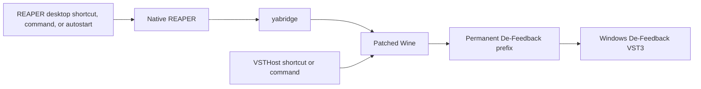

# Alpha Labs De-Feedback on Linux

Run the Windows De-Feedback VST3 with native Linux REAPER, yabridge, and a Wine build with Direct2D and DirectComposition patches. Start with a Focusrite Scarlett over USB at 48 kHz. The setup also includes REAPER routing for one, two, or four independent mono paths.

The De-Feedback editor and license window worked in VSTHost with patched Wine on both Xfce/Xorg and Plasma/Wayland. The permanent REAPER launcher and four physical SQ/CQ USB paths still need end-to-end validation. AES67 is a separate hardware test.



## Test hardware

The reference system is a **Beelink EQ12** with a 12th Gen Intel Alder Lake-N100 processor (4 cores, 4 threads, up to 3.40 GHz), 16 GB DDR5 RAM, a 500 GB SSD, and two 2.5 GbE ports.

## Create a bootable USB drive

1. Download the [Ubuntu Studio 26.04.1 LTS desktop ISO for amd64](https://cdimage.ubuntu.com/ubuntustudio/releases/resolute/release/ubuntustudio-26.04.1-desktop-amd64.iso). The checksum is listed with the [official ISO files](https://cdimage.ubuntu.com/ubuntustudio/releases/resolute/release/).
2. Download [balenaEtcher](https://etcher.balena.io/) for the computer you will use to write the USB drive. On an Apple Silicon Mac, choose the Apple Silicon version of Etcher. Use the `amd64` ISO for the x86-64 target.
3. Use a USB drive with at least 8 GB of capacity. In Etcher, choose **Flash from file**, select the ISO, choose the USB drive under **Select target**, and click **Flash**. Etcher overwrites the contents of the selected drive.
4. Start the target computer from the USB drive using the UEFI boot menu. You can check whether the Scarlett is detected in the live session. If practical, temporarily disconnect the Windows NVMe drive before installing so the Linux bootloader goes on the test SSD. Choose **Minimal installation** on the test SSD. Reconnect the NVMe drive and use the UEFI boot menu to choose which drive to start from.

## Ubuntu Studio or Ubuntu Desktop

The **Ubuntu Studio ISO with Minimal installation** gives you the Studio desktop and audio configuration with a smaller selection of apps. This is the quickest route for this test.

On an existing official **Ubuntu Desktop** installation or Ubuntu flavor, you can add the Studio audio tools and keep your current desktop. Install the package selector and choose the audio components in **Ubuntu Studio Installer**. Sign out and back in if prompted so the realtime audio permissions take effect. Ubuntu Server falls outside the scope of this installer. [Ubuntu Studio Installer](https://ubuntustudio.org/support/ubuntustudio-ubuntustudioinstaller/)

```bash
sudo apt update
sudo apt install ubuntustudio-installer
```

## Test the Scarlett and REAPER

Copy the entire [setup bundle](defeedback-linux/) to the target computer, including the local packages you plan to use. From that directory, run `bash setup-defeedback.sh`. Setup reuses an existing patched Wine build or compiles it, then registers De-Feedback with yabridge. The [setup guide](defeedback-linux/README.md) lists the prerequisites and the initial audio test. It also outlines the [resource download and offline installation](defeedback-linux/docs/installation.md).

Run `bash tools/check-audio.sh` from the setup bundle to check the default Focusrite USB profile. The [audio profiles](defeedback-linux/README.md#audio-profiles) also cover SQ and CQ over USB, and Avantis and dLive over AES67.

1. Connect the Scarlett directly via USB. Linux provides the USB audio driver. The official Focusrite Control software runs on Windows or macOS. [Focusrite on Linux](https://support.focusrite.com/hc/en-gb/articles/208530735-Is-my-Focusrite-Product-compatible-with-Linux)
2. For manual setup, install [REAPER for Linux x86-64](https://www.reaper.fm/download.php) from the Cockos archive. Yabridge requires a native host installation outside Flatpak. [yabridge](https://github.com/robbert-vdh/yabridge#tested-with)
3. In REAPER, choose **ALSA** under **Options → Preferences → Audio → Device**. Select the Scarlett for input and output, set **48 kHz, 64 samples, 24-bit, 3 periods, and RT priority 50**, then click **Apply**. Verify the active format in REAPER. [REAPER User Guide](https://dlx.reaper.fm/userguide/html/)
4. Create one track, select the correct mono input, arm the track and enable input monitoring, then route the master to the desired Scarlett output. Turn off **Direct Monitor** on the Scarlett and check the signal before adding the plugin.

## Open the license window and create a REAPER profile

Use the installed `vsthost` command or desktop shortcut to open **Options → License Management** in the permanent Wine prefix. Close REAPER first. Follow the [license window instructions](defeedback-linux/README.md#license-management-in-vsthost).

Use the [REAPER routing action](defeedback-linux/README.md#reaper-solo-duo-and-quad) to generate Solo, Duo, or Quad. Auto chooses a profile from the input and output channels available to REAPER. Select the interface in REAPER before running the action.

## Measure stability and latency

- The reference system with a Scarlett measured **8.1 ms round-trip latency** with ALSA at **48 kHz and 64 samples**. Measurements were taken both with De-Feedback bypassed and with it active. The test used Open Sound Meter on an independent system, with pink noise among the test signals.
- Use **64 samples** for this Scarlett setup. Smaller blocks caused dropouts or audible clicks. If you test another buffer size, change only that setting between runs.
- For a PipeWire test, check `RATE` and `QUANT` on the active driver row in `pw-top`. Press `c` at the start of each run and monitor `ERR`. For direct ALSA, check the active format in REAPER and listen to or record the physical output. [PipeWire `pw-top`](https://docs.pipewire.org/devel/page_man_pw-top_1.html)
- Run the lowest usable buffer for at least **30 minutes** with a speech recording as input. Record the physical Scarlett output if possible. The demo periodically interrupts the audio, so also test the same route with the plugin bypassed. [Alpha Labs FAQ](https://www.alphalabsaudio.com/defeedback/)
- Measure the delay from physical input to output using the same setup as on Windows. For example, send an impulse to the Scarlett input and record the source signal and Scarlett output simultaneously on a second device. The time between the two impulses is the measured insert latency. Turn off Direct Monitor and measure with the plugin bypassed first. Then repeat with De-Feedback enabled. Its noise suppression can attenuate the pink-noise test signal and reduce the amplitude of the derived impulse response, making the peak harder to identify.
- Record the Scarlett generation, kernel (`uname -r`), patched Wine version (`~/.local/opt/defeedback-wine-dcomp/runtime/bin/wine --version`), yabridge build, REAPER version, sample rate, block size, test duration, and measured latency. For PipeWire, also record any increase in `ERR`. Retest the chosen setting after a cold boot.

## Optional network test with Avantis and AES67

This setup already uses Dante at 48 kHz, with Sennheiser EW-DX as the source and Martin Audio as the output. Use the same sample rate for the AES67 streams and REAPER project. The Avantis processes audio internally at 96 kHz, and the Dante card uses 48 kHz for AES67. [Allen & Heath Dante 64×64](https://www.allen-heath.com/hardware/audio-networking/dante-64x64/) · [Allen & Heath on AES67 and sample rates](https://support.allen-heath.com/hc/en-gb/articles/23638561086353-SMPTE-ST-2110)

For this test, the EW-DX sends audio via Dante to the Avantis channel. The Avantis sends the insert to REAPER and receives the return via AES67. It then sends the mix via Dante to Martin Audio. [Audinate on AES67 interoperability](https://support.getdante.com/hc/en-gb/articles/5508253040927-AES67-Interoperability)

1. Connect the Dante card's **Primary** port and the Linux computer's Ethernet port to the same test network. Open Dante Controller on the Mac, enable **AES67 Mode** on the card, and verify that it is set to 48 kHz. [Audinate on AES67](https://support.getdante.com/hc/en-gb/articles/5508253040927-AES67-Interoperability)
2. On the Avantis, patch one test channel through **Insert A**. Choose **Digital** as the operating level and assign Send and Return to unused outputs and inputs on the Dante I/O port. Create an **AES67 multicast flow** for the send in Dante Controller. Enable the insert once the return works. [Avantis Firmware Reference Guide](https://www.allen-heath.com/content/uploads/2023/05/Avantis-Firmware-Reference-Guide-V1.20.pdf)
3. On Linux, use the [optional PipeWire AES67 setup script](defeedback-linux/README.md#optional-aes67-test-with-pipewire). Check PTP lock, receive the Avantis stream, and send a separate AES67 multicast stream back. Subscribe the Dante card's input to that return stream. The [AES67 Linux Daemon with ALSA RAVENNA](https://github.com/bondagit/aes67-linux-daemon/blob/master/DEVICES.md) is another option.
4. Test the full loop with one mono track in REAPER and the plugin bypassed. Enable De-Feedback and measure the round-trip latency. Record this separately from the Scarlett measurement because the network buffers are part of this loop.

This route still needs an end-to-end hardware test. Record the Dante card revision and firmware, the network interface, and the PTP settings.
