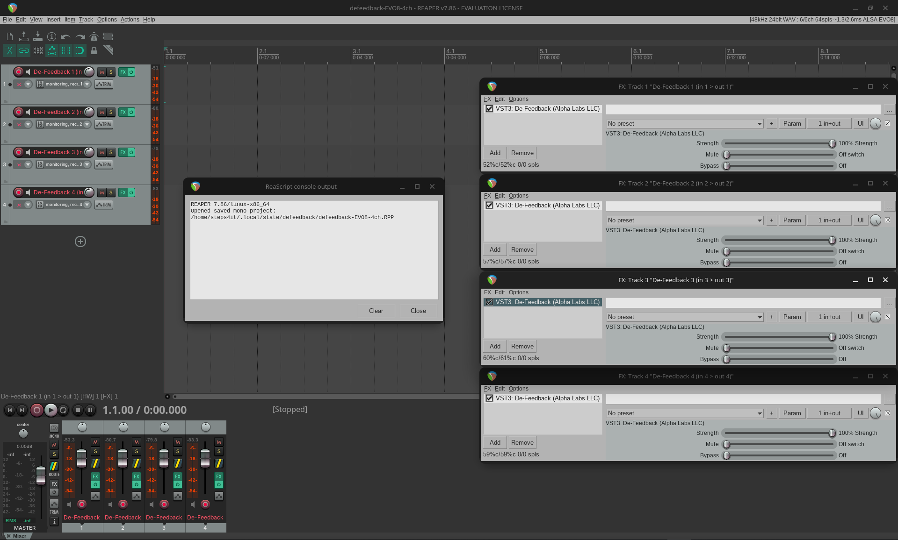
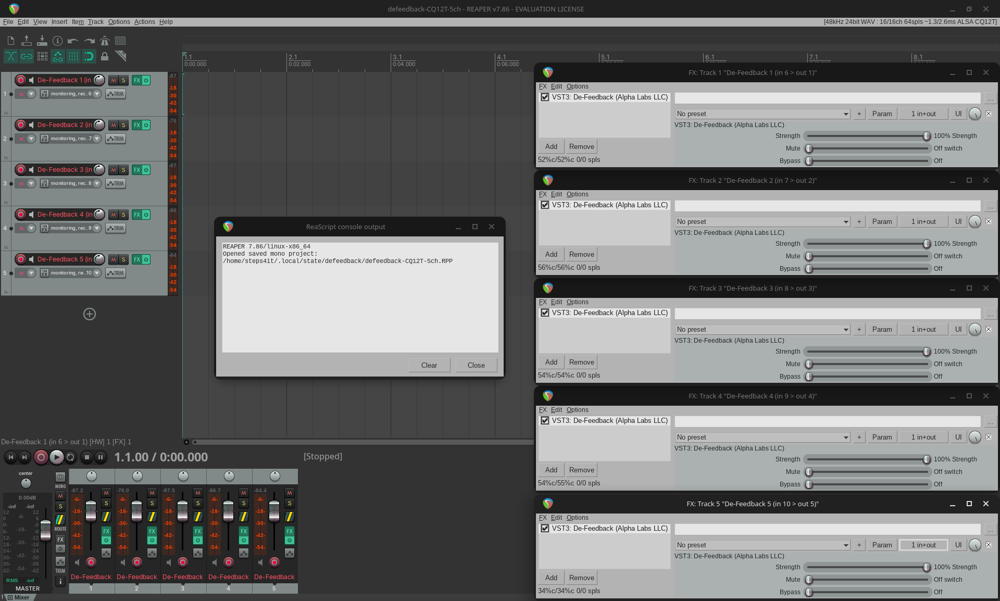
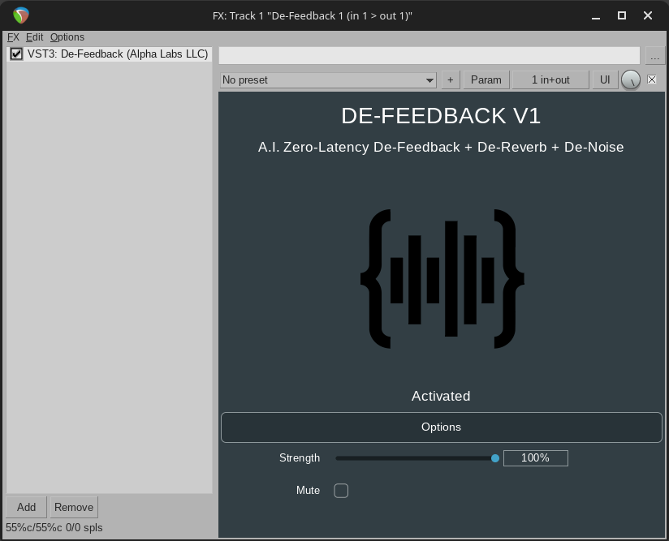
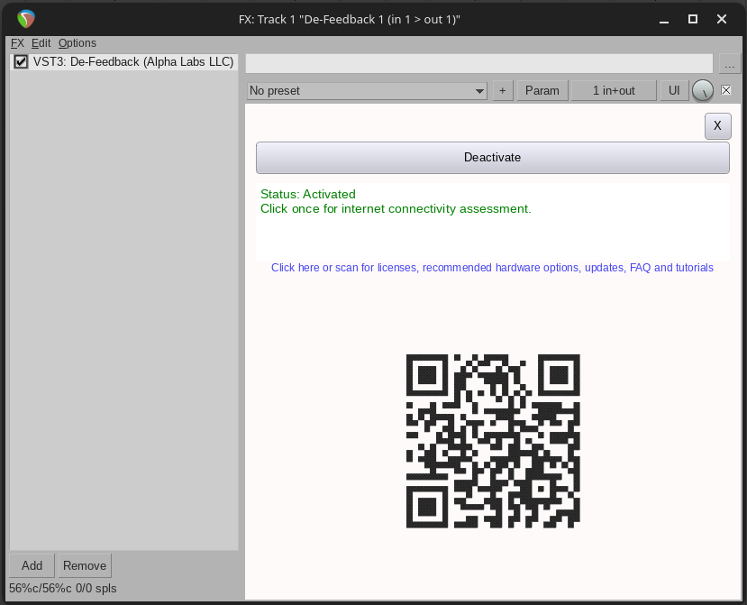

# Alpha Labs De-Feedback on Linux

---

## Disclaimer

Unofficial Linux integration for the Alpha Labs De-Feedback plugin. Not affiliated with or endorsed by Alpha Labs. REAPER and Alpha Labs De-Feedback are separately licensed products. This project includes neither license. Obtain and activate each product according to its vendor's terms.

Products and licensing: [REAPER](https://www.reaper.fm/purchase.php) · [Alpha Labs De-Feedback](https://www.alphalabsaudio.com/defeedback/).

The integration scripts are licensed under [MIT](LICENSE). Third-party software retains its own licenses. See [third-party software and redistribution](docs/installation.md#third-party-software-and-redistribution).

---

## About this project

**Experimental project.** USB operation has been validated on the documented hardware. AES67 integration is under development and still requires end-to-end hardware testing. See [validation status](docs/overview.md#validation-status) for the scope of the completed tests.

Run the Windows De-Feedback VST3 on Ubuntu Studio with native Linux REAPER using yabridge and patched Wine. The hardware-aware launcher selects a supported USB device and opens its mono routing project. The goal is a headless appliance that loads the appropriate audio settings at boot for USB or AES67. USB selection is implemented. Boot without a monitor has been validated. Full automatic AES67 service startup is planned. See [startup selection](https://github.com/psmsmets/defeedback-linux/blob/main/docs/setup.md#startup-selection).

This project grew out of a personal preference for Linux and difficulty obtaining a Windows 11 IoT Enterprise LTSC license. I would rather put that budget toward a REAPER license and explore running De-Feedback on Linux. This is an independent compatibility experiment, with test results and remaining limitations documented here.

- [Documentation](docs/README.md)
- [Workstation command](docs/commands.md)
- [Setup and operation](docs/setup.md)
- [Code and installation bundle](defeedback-linux/)

See [test hardware and measurements](docs/overview.md) for validated configurations.

After installation, run `defeedback-linux` to start REAPER with the detected audio device. Use `defeedback-linux --help` for all available commands and `defeedback-linux --version` when reporting an issue. See the [changelog](CHANGELOG.md) for release notes.

To activate De-Feedback, open its FX window in REAPER and click **UI** to show the plugin editor, then choose **Options → License Management**. Patched Wine supports this directly in REAPER; VSTHost is optional. See [activation in REAPER](docs/setup.md#license-management-in-reaper).

## Install and enable headless startup

Keep a monitor, keyboard, and Internet connection available for the first setup.

1. **Start Ubuntu Studio.** Use its Plasma desktop and connect the Focusrite Scarlett over USB. For a new computer, follow [OS preparation](docs/overview.md#prepare-ubuntu-studio).
2. **Download this project.** On GitHub, choose **Code → Download ZIP** and extract it. Open the inner `defeedback-linux` folder, which contains `setup-defeedback.sh`.
3. **Install.** Create `packages` inside that folder and put the [official installer](https://www.alphalabsaudio.com/defeedback/) there as `DefeedbackSetup.exe`. Open a terminal beside `setup-defeedback.sh` and run `bash setup-defeedback.sh`. Follow the installer windows and wait for completion. Answer **no** to headless setup for now.
4. **Open and activate.** Open a new terminal and run `defeedback-linux`. In REAPER, use De-Feedback's **FX → UI → Options → License Management** to activate the plugin.
5. **Test the sound.** Verify the Scarlett input and output, save the REAPER project, and close REAPER. See [the audio test](docs/setup.md#first-audio-test-with-focusrite).
6. **Enable automatic startup.** Run `defeedback-linux appliance setup`, then reboot. First confirm that REAPER and the audio work automatically; then test booting without the monitor and keyboard.

See [detailed setup](docs/setup.md) and [headless operation](docs/appliance.md) if needed. Headless USB startup uses automatic Plasma login; automatic AES67 services remain planned.

## Commands and help

`defeedback-linux --help` shows the command groups. Each group has its own help, and each action describes its options:

```bash
defeedback-linux appliance --help
defeedback-linux aes67 --help
defeedback-linux vsthost --help
defeedback-linux vsthost install --help
```

See the [command overview](docs/commands.md) for audio checks, logs, updates, and optional tools.

## Screenshots

REAPER after automatic appliance startup on the reference Beelink, with an Audient EVO8 detected over USB and four mono paths using the activated De-Feedback plugin. See [startup and routing](docs/setup.md#dedicated-workstation-startup).



REAPER with an Allen & Heath CQ12T over USB and five mono De-Feedback paths, mapping inputs **6–10 → outputs 1–5**. See [CQ routing](docs/reaper-projects.md#cq-signal-flow-and-channel-mapping).



These results were confirmed on 25 November 2026. See [validation status](docs/overview.md#validation-status) for the tested configurations and remaining work.

De-Feedback's graphical editor opens directly in REAPER after clicking **UI**:



The plugin's **Options → License Management** window shows **Status: Activated**. See the [complete walkthrough, including the Options menu](docs/setup.md#license-management-in-reaper).



## Support this project

If this Linux setup helped you, consider buying me a coffee to support development, documentation, and hardware testing of this unofficial integration.

[](https://buymeacoffee.com/psmsmets)
