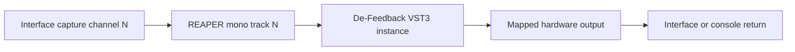

# Install De-Feedback on Ubuntu Studio

Use [the installation reference](docs/installation.md) for the download manifest, offline preparation, and the list of changes setup makes.\n\nCopy the entire `defeedback-linux` folder to the Beelink. In the Ubuntu Studio desktop session, open a terminal in that folder and run the script as your regular user.

```bash
bash setup-defeedback.sh
```

The script uses `sudo` for Ubuntu packages and installs REAPER, yabridge, and patched Wine in your home directory. It reuses a completed build from the patched VSTHost test. On a fresh machine it compiles the Direct2D/DirectComposition Wine fork from source, which can take a while on the N100. The runtime lives at `~/.local/opt/defeedback-wine-dcomp/runtime`. [Wine fork and build notes](https://github.com/giang17/wine/blob/d2d1-dcomp-11.0/PATCHES.md)

Close REAPER and VSTHost before updating an existing installation. Setup updates the permanent `~/.wine-defeedback` prefix in place and reuses its installed VST3. Use the installed REAPER launcher so yabridge gets the patched Wine loader and server. Both applications get desktop and applications-menu entries. The `reaper`, `vsthost`, and `yabridgectl` commands are linked into `~/.local/bin`. Open a new Konsole tab, or run `export PATH="$HOME/.local/bin:$PATH"` for the current terminal. [yabridge Wine configuration](https://github.com/robbert-vdh/yabridge#configuration)

Put the official `DefeedbackSetup.exe` in `packages/`. On a new installation, setup opens it through Wine so each user can review and accept the Alpha Labs terms in the installer. Add your Linux packages to the same directory or supply their directory with `bash setup-defeedback.sh '/path/to/packages'`.

| Package | File name or directory |
| --- | --- |
| REAPER for Linux x86-64 | `reaper*_linux_x86_64.tar.xz` |
| yabridge for x86-64 | `yabridge-*.tar.gz` or its `.tar.gz.zip` wrapper from GitHub Actions |
| yabridgectl | `yabridgectl-*.tar.gz` or `.tar.gz.zip` from the same build if provided separately |
| VSTHost x64 with all companion files | `vsthostx64/` |
| Extracted yabridge | `yabridge/` containing `yabridgectl` and the bridge files |

For missing archives, the script downloads the REAPER version in the resource manifest and checks its published SHA-256. It fetches the current yabridge development build via the project's nightly.link page. APT may also need internet access. Use a development build of yabridge with the patched Wine runtime. [REAPER](https://www.reaper.fm/download.php?hashes=1) · [yabridge](https://github.com/robbert-vdh/yabridge#troubleshooting-common-issues)

## First audio test with Focusrite

Connect the Scarlett and turn off **Direct Monitor**. Open REAPER from the applications menu or run `reaper`. Under **Options → Preferences → Audio → Device**, select **ALSA**, choose the Scarlett for input and output, then apply these settings.

| ALSA setting | Value |
| --- | --- |
| Sample rate | 48000 Hz |
| Block size | 64 samples |
| Bit depth | 24-bit |
| Periods | 3 |
| RT priority | 50 |

REAPER saves the selection for later launches. Check the active audio format in the top right of the REAPER window. If the device cannot open at 64 samples or you hear glitches, try 128 samples. [REAPER User Guide](https://dlx.reaper.fm/userguide/html/)

On the Beelink and Scarlett, ALSA at **48 kHz and 64 samples** measured **8.1 ms round-trip latency**. Measurements were taken both with De-Feedback bypassed and with it active. The test used Open Sound Meter on an independent system, with pink noise among the test signals. Smaller blocks caused dropouts or audible clicks, and the PulseAudio backend produced no audio in this setup.

Scan `~/.vst3` under **Plug-ins → VST**. Create one mono track with input monitoring enabled, check the Scarlett routing in bypass, and then add De-Feedback as an effect.

## Dedicated workstation startup

Run `bash setup-defeedback.sh --appliance` from the Ubuntu Studio Plasma desktop to install De-Feedback and configure startup. If REAPER is already installed, you can run `bash tools/setup-appliance.sh` on its own. Use the account that should log in automatically. Anyone with physical access can use this desktop after boot.

SDDM signs in to the current Plasma session type at boot. The systemd user service waits three seconds and then starts REAPER with its saved preferences. If you want it to reopen a specific De-Feedback project, set that in REAPER before rebooting.

This profile turns off Plasma notification sounds, Baloo file indexing, session restore, and idle screen locking and blanking. It disables system sleep and hibernation and sets the power button to shut down. Plasma uses the performance profile on AC when the machine advertises it. The profile also stops and masks ModemManager and the installed CUPS print services and activation units.

To allow printing or mobile broadband again, unmask the units for that feature. Reboot to start any of those units that were enabled before masking.

```bash
sudo systemctl unmask cups.service cups.socket cups.path cups-browsed.service
sudo systemctl unmask ModemManager.service
```

Reboot when ready and verify that the desktop and REAPER appear. Check the REAPER service with `systemctl --user status defeedback-reaper.service` and its boot log with `journalctl --user -u defeedback-reaper.service -b`. Test the physical power button after saving the project.

To stop REAPER from starting at login, run `systemctl --user disable defeedback-reaper.service`. To turn off automatic login, run `sudo kwriteconfig6 --file /etc/sddm.conf --group Autologin --key User ""`. Setup saves an existing `/etc/sddm.conf` to `/etc/sddm.conf.before-defeedback` on the first run. To restore the system sleep and power-button defaults, remove the `90-defeedback-appliance.conf` files from `/etc/systemd/sleep.conf.d/` and `/etc/systemd/logind.conf.d/`, then reboot. Adjust the corresponding desktop preferences in Plasma System Settings.

## If the Wine installer cannot extract files

Run `bash setup-defeedback.sh` from your Ubuntu Studio desktop session. Setup gives the Alpha Labs installer a writable temporary folder on the Wine C: drive and waits for you to complete the installer:

1. Click **Extract** in the Alpha Labs window.
2. Read the terms in the separate **End User License Agreement EULA** window and click **Accept** if you agree.
3. In **Browse for Folder**, select `C:\Program Files\Common Files\VST3` and click **OK**.
4. Dismiss the success message and close the installer if it is still open. Setup then registers the extracted plugin with yabridge.

Wine's terminal output is saved in `${XDG_STATE_HOME:-$HOME/.local/state}/defeedback/wine-installer.log`.

If extraction under Wine fails, run the official installer on Windows, review the terms, and accept them if you agree. Copy the resulting `Defeedback.vst3` into the Linux setup's `packages/` directory. If it is a folder, copy the whole folder. Then run `bash setup-defeedback.sh --import-vst3` to import the plugin into the Wine prefix and register it with yabridge. For a custom package directory, place the VST3 there and pass that directory after `--import-vst3`.

## License management in VSTHost

Use the supplied full 64-bit VSTHost folder in `packages/vsthostx64/`, including its license and Data folder. The supplied package terms limit VSTHost to private use. The `vsthost` command and desktop shortcut open De-Feedback without audio using the permanent Wine prefix. Close REAPER first. Click the plug-in edit dial, then **Options → License Management**. This is the permanent prefix; the `tools/test-patched-wine.sh patched` command uses a temporary test prefix.

## REAPER Solo, Duo, and Quad

1. Select the correct input and output device in REAPER and verify the available ports. Ensure REAPER has scanned `~/.vst3`.
2. Open a new empty project tab. In **Actions → Show action list → New action → Load ReaScript**, load `~/.local/share/defeedback/defeedback-routing.lua`. This only needs to be registered once. Run the action from the action list or bind a keyboard shortcut.
3. Choose `solo`, `duo`, or `quad` for one, two, or four independent mono inserts. `auto` selects the largest of those profiles that fits the active REAPER input and output ranges. Set the first input and output to the numbers that correspond to the console patch. Subsequent channels use consecutive ports.
4. Each track has its own De-Feedback VST3 and mono hardware output. The master send is disabled. Tracks start muted with the FX bypassed. Verify the console sends and returns before unmuting one track at a time, then enable its FX. Save a separate REAPER project for each device and channel count you use.

For an SQ/CQ Quad test, use four consecutive USB capture channels and four consecutive USB return channels. On CQ, select USB multitrack mode and verify which return sockets the model exposes. The action reads the enabled REAPER ports; it does not change the audio device, change the console patch, or switch an open project when you plug in another device. [REAPER ReaScript API](https://www.reaper.fm/sdk/reascript/reascripthelp.html)



The path above is repeated once for Solo, twice for Duo, and four times for Quad. Use the first input and output fields to match the USB sockets assigned on the console.

## Audio profiles

**Focusrite Scarlett over USB is the default and the first test.** The Scarlett is an audio interface for this profile. The SQ and CQ supply their own USB audio, while the Avantis and dLive profiles use an AES67 endpoint on Linux.

```bash
bash tools/check-audio.sh
bash tools/check-audio.sh focusrite --launch
bash tools/check-audio.sh sq
bash tools/check-audio.sh cq
bash tools/check-audio.sh avantis
bash tools/check-audio.sh dlive
```

The checker lists the devices and PipeWire connections that Linux sees. For the USB profiles, select the appropriate capture and playback device in REAPER with ALSA. Start with 48 kHz and 128 samples on SQ/CQ, then lower the buffer after verifying the four paths. The USB launches use REAPER's saved audio preferences. For AES67, `--launch` starts REAPER with PipeWire-JACK at 48 kHz and 128 samples. Select JACK in REAPER after the AES67 capture and playback ports appear. If using an ALSA RAVENNA device directly, select it in REAPER's ALSA settings.

| Profile | Connection and routing |
| --- | --- |
| `focusrite` | Connect the Scarlett by USB. With a console, patch an analog line send to the Scarlett line input and its line output to the console return. Turn off Direct Monitor. [Focusrite USB support](https://support.focusrite.com/hc/en-gb/articles/208530735-Is-my-Focusrite-Product-compatible-with-Linux) |
| `sq` | Use the SQ USB-B port at 48 kHz. Assign one channel's insert send and return to unused USB sockets and select the **Digital** operating level. Connect the matching capture and playback channels in REAPER. [SQ USB-B](https://support.allen-heath.com/hc/en-gb/articles/45947079593105-SQ-SQ-Drive-and-USB-B) · [SQ inserts](https://support.allen-heath.com/hc/en-gb/articles/45946563062929-SQ-Processing) |
| `cq` | Use USB-B in multitrack mode at 48 kHz. Send one input to REAPER and return it to a separate CQ channel with **USB/SD** as its source. Use the routing table for your CQ model to choose the return socket. Keep the dry channel out of the listening mix during the test and keep the return out of the USB send feeding REAPER. [CQ USB-B routing](https://support.allen-heath.com/hc/en-gb/articles/31464715078929-CQ-USB-B-Routing) |
| `avantis` | Use a Dante card with AES67 enabled at 48 kHz. Patch the insert to unused card sockets and create separate AES67 multicast flows for the send and return. Verify PTP lock and both directions before enabling the insert. [Dante card setup](https://support.allen-heath.com/hc/en-gb/articles/40487771409937-M-DL-DANT64-M-DL-DANT128-Fitting-Note) · [Linux AES67 examples](https://github.com/bondagit/aes67-linux-daemon/blob/master/DEVICES.md) |
| `dlive` | Use the same 48 kHz AES67 test with a compatible Dante card in a dLive I/O port. Verify the installed card revision, firmware, and PTP lock. Patch the send and return to unused card sockets on the dLive. [Dante card setup](https://support.allen-heath.com/hc/en-gb/articles/40487771409937-M-DL-DANT64-M-DL-DANT128-Fitting-Note) · [Audinate AES67 interoperability](https://support.getdante.com/hc/en-gb/articles/5508253040927-AES67-Interoperability) |

For each profile, verify the physical return in bypass, then enable De-Feedback. Measure a bypass baseline before testing with De-Feedback enabled. Noise suppression can attenuate a pink-noise test signal, leaving a smaller impulse-response peak in Open Sound Meter. Record the active rate and buffer, test duration, audible glitches, and measured insert latency. For PipeWire, test 128, 64, and 32 samples in that order. Reset the `ERR` display with `c` in `pw-top` at the start of each run and record any increase. For AES67 also record the PTP lock status and network buffer settings. Retest the chosen configuration after a cold boot. The profiles still need hardware validation. [PipeWire `pw-top`](https://docs.pipewire.org/page_man_pw-top_1.html)

The installer and downloaded packages stay local. When setting up from a Git checkout, create `packages/` and place the [official Alpha Labs Windows installer](https://www.alphalabsaudio.com/defeedback/) in it.

## Optional AES67 test with PipeWire

Run this on the Beelink's Ubuntu Studio desktop after the Focusrite test. The [PipeWire AES67 profile](https://github.com/PipeWire/pipewire/blob/1.6.2/src/daemon/pipewire-aes67.conf.in) uses PTPv2 to sync the Ethernet hardware clock and SAP to discover and announce AES67 streams. Inferno implements native Dante; it does not transmit or receive AES67 audio. [Inferno protocol support](https://github.com/teodly/inferno#comparison-with-other-aoip-virtual-soundcards)

```bash
sudo apt install iproute2 ethtool linuxptp pipewire pipewire-bin
ip -br -4 addr
bash tools/setup-aes67.sh enp2s0 239.69.150.244
```

Replace `enp2s0` with the wired interface connected to the Dante Primary network. Choose a free return multicast address in `239.69.0.0/16` that matches the Dante card's configured AES67 receive prefix. The address must differ from the Avantis send group. The example assumes PTPv2 domain 0 and UDP IPv4 with E2E delay measurement. The script checks for IPv4, hardware TX/RX timestamping, and a PTP device readable by your user. A VM's virtual NIC may lack that hardware clock.

1. In Dante Controller, enable AES67 on the Avantis or dLive Dante card at **48 kHz** and create one AES67 multicast send using an unused output. Keep the insert bypassed while setting up the loop.
2. Run the commands printed by the script. Start the foreground [`ptp4l` client](https://www.linuxptp.org/documentation/ptp4l/) only if no other PTP instance is managing that interface. Confirm that the port is in `SLAVE` state and tracking the expected grandmaster before starting the PipeWire helper. The helper runs in your desktop session and exports nodes to the existing PipeWire graph.
3. Run `bash tools/check-audio.sh avantis --launch` (or `dlive --launch`). In REAPER, select JACK and use the console's advertised AES67 source and the `defeedback-aes67-return` sink. Use the first channel of the two-channel return for the mono test. In Dante Controller, subscribe an unused Dante receive channel to channel 1 of **De-Feedback Return** and patch it to the console's insert return.
4. Verify the send and return with De-Feedback bypassed. Start at **48 kHz / 128 samples**, then measure round-trip latency and watch `pw-top` for errors before testing smaller buffers.

Stop the PipeWire helper and then the PTP client with Ctrl+C in their terminals to end the test. The script only writes `pipewire-aes67.conf` in `${XDG_CONFIG_HOME:-$HOME/.config}/defeedback/`; it does not change the regular audio service or enable autostart. The Avantis and dLive routes still need validation on hardware.\n