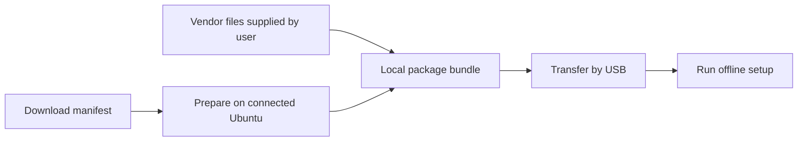

# Installation reference

Run the commands from the top level of the Linux bundle.

| Path | Role |
| --- | --- |
| `download-resources.sh` | Downloads or identifies resources. Writes to the selected package directory. |
| `setup-defeedback.sh` | Installs the audio workstation for the current Ubuntu Studio user. |
| `config/` | Download URLs, filenames, checksums where available, and Ubuntu package lists. |
| `src/` | Build and launch scripts, plus the REAPER routing action. Setup installs the launchers and routing action. |
| `tools/` | Audio checks, GUI tests, optional appliance setup and optional AES67 setup. |
| `packages/` | Local downloads and user-supplied files. Git ignores this directory. |

## Prepare resources

On a connected machine with Bash and curl, run:

```bash
bash download-resources.sh
```

The script reads [the resource manifest](../config/resources.conf) and collects the pinned REAPER archive, the matching yabridge development archives, and the patched Wine source. The REAPER archive is checked against its published SHA-256. The yabridge and Wine entries follow their respective branches. For repeatable deployments, keep the collected files or update the manifest to fixed artifact URLs and hashes. `--config FILE` selects a different manifest, `--output DIR` changes the package directory, and `--only RESOURCE` selects a single entry. Each line uses `resource|kind|name|https-url|sha256`. Use `-` when an upstream checksum is unavailable. A `file` entry can also point to a repository ZIP or another direct artifact you have access to.

Download the official Windows De-Feedback installer from Alpha Labs and place it at `packages/DefeedbackSetup.exe`. The installer presents the vendor terms during setup. VSTHost is optional. For private use with the supplied edition, place its complete folder in `packages/vsthostx64/`, including the executable, license and Data folder. See [Alpha Labs downloads and terms](https://alphalabsaudio.com/defeedback/) and the [REAPER distribution agreement](https://www.reaper.fm/dist-agreement.php). Direct downloads from upstream to a user's own package directory are separate from distributing copies in a customer bundle. Before supplying a bundle to others, check each component's distribution terms, including any source obligations for open-source binaries.

## Change the selected versions

Edit `config/resources.conf` to change the defaults for downloads and new installations. For REAPER, update the Linux x86-64 archive name, URL, and published SHA-256 together. For Wine, select a source tarball from the patched fork. A commit archive and SHA-256 pin it to an exact revision. To pin yabridge, replace its `nightly` entry with one or two `file` entries under the resource name `yabridge`. Use a combined archive containing `yabridgectl` or a bridge and control archive from the same build. Keep the upstream archive names so setup can find and match them.

Prepare updated versions in an empty package directory to avoid mixing old and new archives. Pass that directory to setup as its positional argument. Setup reuses existing REAPER, yabridge, and Wine installations and cached Wine source. The manifest changes the inputs for a fresh install or build.

## Transfer to a disconnected target



On a connected **Ubuntu amd64** machine with the same Ubuntu release and compatible package sources as the target, refresh the APT indexes and run:

```bash
sudo apt-get update
bash download-resources.sh --apt
```

This adds the runtime and Wine build APT archives, their checksums, and the Ubuntu release and architecture marker. Copy the entire Linux bundle, including `packages/` and any manually supplied files, to the target. Run setup from the target desktop:

```bash
bash setup-defeedback.sh --offline
```

Offline setup uses the prepared local archives and can build Wine from the local source tarball. License activation is a separate step. The clean-machine offline install still needs validation on Ubuntu Studio with networking disabled.

## What setup changes

| Area | Changes |
| --- | --- |
| Ubuntu packages | Uses `sudo` to install the runtime packages from [the APT package list](../config/apt-packages.conf). A new Wine build also installs the build group. |
| REAPER | Installs to `~/.local/opt/REAPER` and keeps any existing audio preferences. |
| Patched Wine | Builds or reuses `~/.local/opt/defeedback-wine-dcomp/runtime`. The Wine source and build logs stay on the machine. |
| De-Feedback and yabridge | Updates `~/.wine-defeedback`, installs the plugin when needed, and registers it with yabridge. The bridge lives in `~/.local/share/yabridge` and creates wrappers under `~/.vst3/yabridge`. |
| Launchers and routing | Installs launchers and the routing action under `~/.local/share/defeedback`, links commands in `~/.local/bin`, and creates application menu and desktop entries. Setup adds `~/.local/bin` to the shell startup file if needed. VSTHost is installed when its local folder is present. |
| Existing appliance service | Migrates an existing De-Feedback REAPER service to the current launcher when needed. |
| Optional `--appliance` | Configures SDDM autologin, the systemd user service for REAPER, Plasma desktop and power settings, system sleep and power-button behavior, and disables ModemManager and CUPS. See [workstation startup](../README.md#dedicated-workstation-startup). |
| Optional AES67 | `tools/setup-aes67.sh` prepares the PipeWire AES67 configuration. See [the separate AES67 test](../README.md#optional-aes67-test-with-pipewire). |
