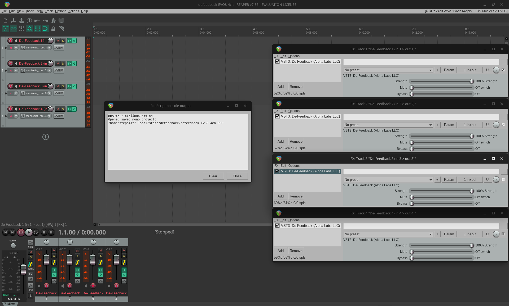

# Headless operation and appliance settings

The goal is headless operation with audio settings selected at boot for the connected USB interface or AES67 on the second NIC. USB selection is implemented; automatic AES67 startup remains planned. A graphical Plasma session is still required. Boot without a monitor has been validated on the reference Beelink. De-Feedback activation and EVO8 appliance autostart with four mono instances have been confirmed; see [validation status](overview.md#validation-status).

Installation and boot startup are separate steps. First run `bash setup-defeedback.sh` from the Linux bundle directory. After installation, optionally enable desktop autologin and REAPER autostart:

```bash
defeedback-linux appliance setup
```

For a new workstation, `bash setup-defeedback.sh --appliance` installs De-Feedback and configures startup in one step. The interactive installer offers this step at the end, defaulting to no. Noninteractive setup only prints the next steps unless `--appliance` is supplied. Use `--no-appliance` to skip the question. Existing startup configuration is kept and is not disabled by that flag. Updates do not enable appliance settings. An existing installation can run `defeedback-linux appliance setup` directly. Use the account that should log in automatically, from its Ubuntu Studio Plasma desktop. Anyone with physical access can use this desktop after boot.

SDDM signs in to the current Plasma session type at boot. The systemd user service waits three seconds and calls the same hardware-aware launcher as the desktop shortcut. The launcher waits up to ten seconds for a recognized USB capture/playback device, selects its ALSA preferences, and creates or reopens its mono project. A graphical user session is still required for REAPER and the plugin; startup runs without interaction after automatic login. See [automatic USB startup](setup.md#automatic-usb-startup).

If the installer finds an existing REAPER user-service file, it keeps that setup and skips the question. Run `defeedback-linux appliance setup` explicitly to enable or reapply the full profile.

This profile turns off Plasma notification sounds, Baloo file indexing, session restore, and idle screen locking and blanking. It disables system sleep and hibernation and sets the power button to shut down. Plasma uses the performance profile on AC when the machine advertises it. The profile also stops and masks ModemManager and the installed CUPS print services and activation units.

To allow printing or mobile broadband again, unmask the units for that feature. Reboot to start any of those units that were enabled before masking.

```bash
sudo systemctl unmask cups.service cups.socket cups.path cups-browsed.service
sudo systemctl unmask ModemManager.service
```

Reboot when ready and verify that the desktop and REAPER appear. Check the REAPER service with `systemctl --user status defeedback-reaper.service` and its boot log with `journalctl --user -u defeedback-reaper.service -b`. See [service status and troubleshooting](logging.md#check-the-autostart-service) for the status commands and their meaning. Test the physical power button after saving the project.

The reference Beelink successfully started REAPER 7.86 automatically with the Audient EVO8 connected and reopened its four-mono-path project with the activated De-Feedback plugin. The screenshot shows ALSA EVO8 at 48 kHz, 24-bit, and 64 samples, with each plugin exposing one input and one output.



To stop REAPER from starting at login, run `systemctl --user disable defeedback-reaper.service`. To turn off automatic login, run `sudo kwriteconfig6 --file /etc/sddm.conf --group Autologin --key User ""`. Setup saves an existing `/etc/sddm.conf` to `/etc/sddm.conf.before-defeedback` on the first run. To restore the system sleep and power-button defaults, remove the `90-defeedback-appliance.conf` files from `/etc/systemd/sleep.conf.d/` and `/etc/systemd/logind.conf.d/`, then reboot. Adjust the corresponding desktop preferences in Plasma System Settings.

## Application cleanup

Preview optional desktop and creative application removal:

```bash
defeedback-linux appliance trim --check
defeedback-linux appliance trim --apply
```

Add `--autoremove` to both commands to include unused automatic dependencies. The script saves the resolved plan under `~/.local/state/defeedback/logs/` and stops if protected desktop, audio, AES67, or system runtime packages would be removed. Review the plan before applying it. Personal documents are retained; Snap removal normally retains a recovery snapshot.
