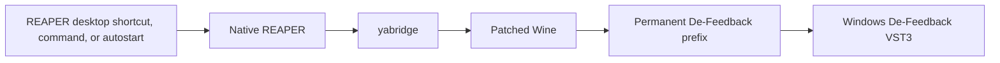

# Alpha Labs De-Feedback on Linux

Run the Windows De-Feedback VST3 with native Linux REAPER, yabridge, and a Wine build with Direct2D and DirectComposition patches. Start with a Focusrite Scarlett over USB at 48 kHz. Mono routing templates support up to eight independent paths.

USB audio has been tested with the interfaces listed below. AES67 audio and eight simultaneous mono paths still require hardware validation.

## Test hardware

The reference system is a **Beelink EQ12** with a 12th Gen Intel Alder Lake-N100 processor (4 cores, 4 threads, up to 3.40 GHz), 16 GB DDR5 RAM, a 500 GB SSD, and two Intel i226 2.5 GbE network interfaces.

Tested USB hardware: Focusrite Scarlett Solo 3rd Gen, Audient EVO8, Behringer U-PHORIA UMC202HD, Allen & Heath SQ, and Allen & Heath CQ12T. See [validated channel counts and settings](setup.md#first-audio-test-with-focusrite).

Focusrite Scarlett is the default interface for this Linux project. Alpha Labs recommends Focusrite Scarlett for its Windows setup; this does not constitute vendor validation of the Linux configuration. [Alpha Labs hardware guidance](https://alphalabsaudio.com/defeedback/)

## Validation status

| Area | Status |
| --- | --- |
| USB audio | Scarlett Solo 3rd Gen: 2 mono instances; UMC202HD: 2; EVO8: 4; CQ12T: 5. SQ USB audio tested; eight-mono operation not validated. |
| Capacity | Four stereo instances ran stably. Mono operation approximately halved CPU load, supporting an eight-mono expectation; eight is the software limit and remains untested. |
| Plugin editor and license | The operator confirmed that the graphical editor opens directly in REAPER with patched Wine using the **UI** button. The activated plugin loaded with four mono EVO8 paths and five mono CQ12T paths. See [activation in REAPER](setup.md#license-management-in-reaper). VSTHost remains optional. |
| AES67 | Prepared for Avantis Solo with Dante 64 V3; four-mono audio and latency tests are next; eight-mono capacity testing follows. |
| Unattended live operation | EVO8 appliance autostart with four mono instances of the activated plugin confirmed. Boot without a monitor has also been validated on the reference Beelink. An opt-in early AES67 fallback is available for testing; automatic PTP/audio services remain planned; automatic recovery is not implemented. See [startup](setup.md#dedicated-workstation-startup). |

On **25 November 2026**, the operator confirmed successful De-Feedback activation and appliance autostart into REAPER 7.86 with the Audient EVO8 and four mono instances. The [REAPER activation walkthrough](setup.md#license-management-in-reaper) shows the native FX window, the plugin's Options menu, and **Status: Activated**. The REAPER routing screenshots show saved device-specific projects with one input and one output per plugin:

| Device | Mono paths | Inputs → outputs | Screenshot |
| --- | --- | --- | --- |
| Audient EVO8 | 4 | 1–4 → 1–4 | [EVO8 four-path project](images/defeedback-reaper-evo8-4ch.png) |
| Allen & Heath CQ12T | 5 | 6–10 → 1–5 | [CQ12T five-path project](images/defeedback-reaper-cq12t-5ch.png) |

Both REAPER screenshots show ALSA at 48 kHz, 24-bit, and 64 samples. They document the loaded projects; appliance autostart was explicitly confirmed with the EVO8. These screenshots do not add a latency measurement or a sustained audio stability result. REAPER is shown under its evaluation license, separate from De-Feedback activation.

## Prepare Ubuntu Studio

Use **Ubuntu Studio 26.04.1 LTS, amd64**, with its Plasma desktop. Download the ISO and verify its checksum from the [official release directory](https://cdimage.ubuntu.com/ubuntustudio/releases/resolute/release/). Write it to a USB drive of at least 8 GB with [balenaEtcher](https://etcher.balena.io/), boot the Beelink from USB, and choose **Minimal installation**. Writing the image erases the USB drive; installation erases the selected target disk.

## Install and run

Copy the [Linux bundle](../defeedback-linux/) to Ubuntu Studio and follow [setup and operation](setup.md). Use the Scarlett for the initial USB audio test. The launcher selects a supported USB device and generates its mono project; [manual templates](reaper-projects.md) are available for other routing, including AES67. Open the plugin editor with REAPER's **UI** button for [license management](setup.md#license-management-in-reaper).

## Measure stability and latency

- The reference system with a **Focusrite Scarlett Solo 3rd Gen** measured **8.1 ms round-trip latency with De-Feedback active**, using ALSA at **48 kHz and 64 samples**. The external measurement system was a **MacBook with M1 Pro**, **Audient EVO8**, and **Open Sound Meter v1.55**, using an impulse response derived from pink noise.
- Use **64 samples** for this Scarlett setup. Smaller blocks caused dropouts or audible clicks. If you test another buffer size, change only that setting between runs.
- For a PipeWire test, check `RATE` and `QUANT` on the active driver row in `pw-top`. Press `c` at the start of each run and monitor `ERR`. For direct ALSA, check the active format in REAPER and listen to or record the physical output. [PipeWire `pw-top`](https://docs.pipewire.org/devel/page_man_pw-top_1.html)
- Test the chosen setting for at least **30 minutes**, monitor glitches, and repeat after a cold boot. Record the audio backend, software versions, channel count, rate, buffer, and latency. Measure bypass and active processing separately; do not treat a block duration as round-trip latency.

## Optional AES67 test

The reference console is an **Allen & Heath Avantis Solo** with an **Allen & Heath Dante 64 V3** card. Use Dante/AES67 at **48 kHz**, matching the REAPER project.

The planned insert loop is Avantis Solo → AES67 → Linux De-Feedback → AES67 → Avantis Solo. Follow [AES67 setup and testing](aes67.md). This audio path has not yet been validated on hardware.
