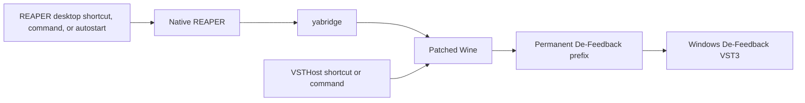

# Alpha Labs De-Feedback on Linux

Run the Windows De-Feedback VST3 with native Linux REAPER, yabridge, and a Wine build with Direct2D and DirectComposition patches. Start with a Focusrite Scarlett over USB at 48 kHz. The setup also includes REAPER mono routing templates for up to eight independent paths. Five mono paths have been validated on CQ12T; the eight-path configuration is pending an AES67 test.

USB audio has been tested with the interfaces listed below. AES67 audio and eight simultaneous mono paths still require hardware validation.

## Test hardware

The reference system is a **Beelink EQ12** with a 12th Gen Intel Alder Lake-N100 processor (4 cores, 4 threads, up to 3.40 GHz), 16 GB DDR5 RAM, a 500 GB SSD, and two Intel i226 2.5 GbE network interfaces.

USB audio hardware used in testing: Focusrite Scarlett Solo 3rd Gen, Audient EVO8, Behringer U-PHORIA UMC202HD, Allen & Heath SQ, and Allen & Heath CQ12T. Test outcomes and settings are recorded in [setup and operation](setup.md#first-audio-test-with-focusrite); inclusion here does not mean every channel configuration has been validated.

Focusrite Scarlett is the default interface for this Linux project. Alpha Labs recommends Focusrite Scarlett for its Windows setup; this does not constitute vendor validation of the Linux configuration. [Alpha Labs hardware guidance](https://alphalabsaudio.com/defeedback/)

## Prepare Ubuntu Studio

Use **Ubuntu Studio 26.04.1 LTS, amd64**, with its Plasma desktop. Download the ISO and verify its checksum from the [official release directory](https://cdimage.ubuntu.com/ubuntustudio/releases/resolute/release/). Write it to a USB drive of at least 8 GB with [balenaEtcher](https://etcher.balena.io/), boot the Beelink from USB, and choose **Minimal installation**. Writing the image erases the USB drive; installation erases the selected target disk.

## Install and run

Copy the [Linux bundle](../defeedback-linux/) to Ubuntu Studio and follow [setup and operation](setup.md). Use the Scarlett for the initial USB audio test. The launcher selects a supported USB device and generates its mono project; [manual templates](reaper-projects.md) are available for other routing, including AES67. License management uses the optional VSTHost launcher.

## Measure stability and latency

- The reference system with a **Focusrite Scarlett Solo 3rd Gen** measured **8.1 ms round-trip latency with De-Feedback active**, using ALSA at **48 kHz and 64 samples**. The external measurement system was a **MacBook with M1 Pro**, **Audient EVO8**, and **Open Sound Meter v1.55**, using an impulse response derived from pink noise.
- Use **64 samples** for this Scarlett setup. Smaller blocks caused dropouts or audible clicks. If you test another buffer size, change only that setting between runs.
- For a PipeWire test, check `RATE` and `QUANT` on the active driver row in `pw-top`. Press `c` at the start of each run and monitor `ERR`. For direct ALSA, check the active format in REAPER and listen to or record the physical output. [PipeWire `pw-top`](https://docs.pipewire.org/devel/page_man_pw-top_1.html)
- Test the chosen setting for at least **30 minutes**, monitor glitches, and repeat after a cold boot. Record the audio backend, software versions, channel count, rate, buffer, and latency. Measure bypass and active processing separately; do not treat a block duration as round-trip latency.

## Optional network test with Avantis and AES67

This setup already uses Dante at 48 kHz, with Sennheiser EW-DX as the source and Martin Audio as the output. Use the same sample rate for the AES67 streams and REAPER project. The Avantis processes audio internally at 96 kHz, and the Dante card uses 48 kHz for AES67. [Allen & Heath Dante 64×64](https://www.allen-heath.com/hardware/audio-networking/dante-64x64/) · [Allen & Heath on AES67 and sample rates](https://support.allen-heath.com/hc/en-gb/articles/23638561086353-SMPTE-ST-2110)

The planned reference loop is EW-DX → Avantis → Linux De-Feedback inserts → Avantis → Martin Audio. Follow [AES67 setup and testing](aes67.md); measure this loop separately from the Scarlett USB result.
