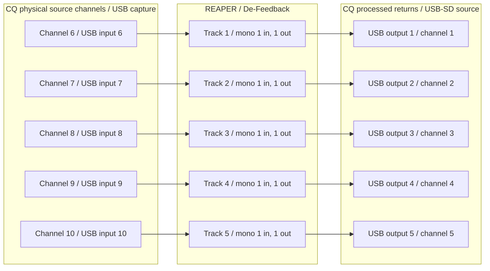
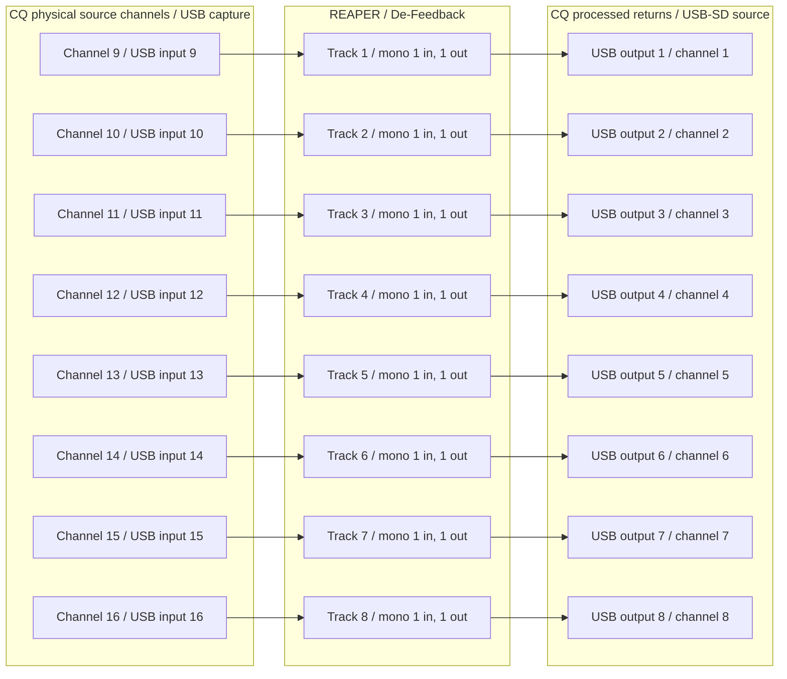

# De-Feedback REAPER projects

## Create a mono project template

Load `create-template.lua` through **Actions > Show action list > New action > Load ReaScript**. Keep the script beside the supplied `defeedback-2ch.RPP`, which provides the De-Feedback plugin state. Open a new empty project tab, run the action, and select a profile.

| Profile | Generated file in `templates/` | Hardware inputs → outputs | Intended use |
| --- | --- | --- | --- |
| `1ch` | `defeedback-1ch.RPP` | 1 → 1 | One mono insert |
| `2ch` | `defeedback-2ch.RPP` | 1–2 → 1–2 | Two mono inserts |
| `4ch` | `defeedback-4ch.RPP` | 1–4 → 1–4 | Four mono inserts |
| `8ch` | `defeedback-8ch.RPP` | 1–8 → 1–8 | QU, SQ, or AES67 inserts |
| `cq12t-5ch` | `defeedback-cq12t-5ch.RPP` | 6–10 → 1–5 | Five CQ12T USB returns |
| `cq18t-8ch` | `defeedback-cq18t-8ch.RPP` | 9–16 → 1–8 | Eight CQ18T USB returns |
| `cq20b-8ch` | `defeedback-cq20b-8ch.RPP` | 9–16 → 1–8 | Eight CQ20B USB returns |

The action loads one instance at a time, requests a mono plugin bus, and checks that the plugin exposes exactly one input and one output before adding the next track. It preserves the first supplied duo track's plugin parameters, assigns fresh track and FX identifiers, enables monitoring and FX, disables the master send, and creates one post-fader mono hardware output per track. Tracks are unmuted. The project sample rate is explicitly set to 48000 Hz. Generated files are saved separately from the supplied projects. Move or rename an existing generated file before regenerating that profile.

The same eight-channel insert template can serve QU, SQ, and AES67 when REAPER exposes the expected ports in order. Audio-device selection and AES67 network connections belong to the startup configuration. The action does not alter the mixer configuration. The CQ18T/CQ20B eight-channel mappings and the eight-mono performance ceiling still require hardware validation.

Use the Focusrite Scarlett over USB for setup and initial audio tests. Configure all USB device profiles for **48000 Hz, 24-bit, 64 samples, and 3 periods**, including the Behringer UMC202HD. Its earlier successful 32-sample test remains a measurement. Configure AES67 network buffering separately.

In the user's test, four stereo plugin instances could run, while a fifth caused REAPER to hang. Switching the plugin bus to mono approximately halved CPU load. The working assumption is a maximum of four stereo or eight mono instances, pending further testing. Verify actual mono I/O and sustained audio performance on the target Linux computer.

The action uses REAPER's documented [channel configuration and FX I/O APIs](https://www.reaper.fm/sdk/reascript/reascripthelp.html#TrackFX_SetNamedConfigParm). Plugin bus requests are advisory, so creation stops and removes the newly created tracks if the plugin does not expose mono I/O. REAPER and De-Feedback runtime validation on the target computer is still required.

## CQ signal flow and channel mapping

The processed USB returns occupy the first mixer channels. Connect microphones to the physical source inputs shown on the left. Set the corresponding return channels on the right to **USB/SD**. Mix the processed returns into the listening mix and keep the dry source channels out of that mix while maintaining their USB sends. Keep the returns out of the USB sends feeding REAPER.

Each REAPER track contains one active De-Feedback instance with a one-input, one-output mono bus and one mono hardware send. Disable **Master/parent send** on every track. The REAPER output numbers below refer to USB playback channels returning to the CQ.

### CQ12T — five mono paths

### CQ18T / CQ20B — eight mono paths

This mapping and sustained operation with eight mono instances still require hardware validation.

The channel order is fixed by the project. For CQ12T, the five paths are **6 → 1, 7 → 2, 8 → 3, 9 → 4, 10 → 5**. For CQ18T/CQ20B, they are **9 → 1, 10 → 2, 11 → 3, 12 → 4, 13 → 5, 14 → 6, 15 → 7, 16 → 8**. Configure the console separately; the launcher selects the REAPER routing for the detected model.

## Supplied files

The source projects are `defeedback-1ch.RPP`, `defeedback-2ch.RPP`, `defeedback-4ch.RPP`, and `defeedback-cq12t-5ch.RPP`. They are preserved as supplied. The one-channel source uses input 2, has its master send enabled, and stores a 44100 Hz project sample-rate value. The CQ12T source has two hardware sends per track. The template action replaces those routing choices with the mappings above and checks the plugin bus through REAPER instead of inferring mono operation from hardware routing.

`reaper-cq12t.ini` and `reaper-evo8.ini` are captured Linux device configurations. Both use 48000 Hz, 24-bit, 64 samples, and 3 periods. They also contain machine-specific window positions, recent files, and project paths; the automatic launcher removes startup project paths and applies the detected device settings to its own INI.

Audio device preferences are normally stored in `~/.config/REAPER/reaper.ini` on Linux. Use **Options > Show REAPER resource path in explorer/finder** to locate the active resource directory. A `.RPP` saves routing, FX state, and project sample-rate settings. Filenames are case-sensitive on Linux.

## Automatic use

After setup installs these resources, the desktop shortcut and automatic startup select a USB device and invoke this action without prompts on the first launch. Generated projects are stored per device and channel count in `~/.local/state/defeedback/`; subsequent launches reopen them. Manual action use continues to save under `projects/templates/`. See [automatic USB startup](setup.md#automatic-usb-startup) for selection rules, overrides, and logs.
