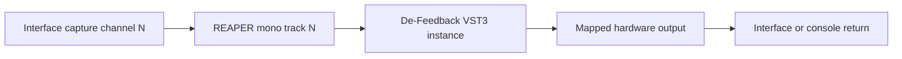

# Install De-Feedback on Ubuntu Studio

Use [the installation reference](installation.md) for the download manifest, offline preparation, and the list of changes setup makes.

Copy the entire `defeedback-linux` folder to the target computer. In the Ubuntu Studio desktop session, open a terminal in that folder and run the script as your regular user.

```bash
bash setup-defeedback.sh
```

The script uses `sudo` for Ubuntu packages and installs REAPER, yabridge, and patched Wine in your home directory. It reuses a completed build from the patched VSTHost test. On a fresh machine it compiles the Direct2D/DirectComposition Wine fork from source, which can take a while on the target computer. The runtime lives at `~/.local/opt/defeedback-wine-dcomp/runtime`. [Wine fork and build notes](https://github.com/giang17/wine/blob/d2d1-dcomp-11.0/PATCHES.md)

Close REAPER and VSTHost before updating an existing installation. Setup updates the permanent `~/.wine-defeedback` prefix in place and reuses its installed VST3. Use the installed REAPER launcher so yabridge gets the patched Wine loader and server. Both applications get desktop and applications-menu entries. The `reaper`, `vsthost`, and `yabridgectl` commands are linked into `~/.local/bin`. Open a new Konsole tab, or run `export PATH="$HOME/.local/bin:$PATH"` for the current terminal. [yabridge Wine configuration](https://github.com/robbert-vdh/yabridge#configuration)

Download the Windows installer and optional VSTHost x64 archive manually from Alpha Labs. Complete the three acknowledgements on the website, then put `DefeedbackSetup.exe` in `packages/` and extract VSTHost to `packages/vsthostx64/` if you need it. [Alpha Labs download page](https://www.alphalabsaudio.com/defeedback/) On a new installation, setup opens it through Wine so each user can review and accept the Alpha Labs terms in the installer. Add your Linux packages to the same directory or supply their directory with `bash setup-defeedback.sh '/path/to/packages'`.

| Package | File name or directory |
| --- | --- |
| REAPER for Linux x86-64 | `reaper*_linux_x86_64.tar.xz` |
| yabridge for x86-64 | `yabridge-*.tar.gz` or its `.tar.gz.zip` wrapper from GitHub Actions |
| yabridgectl | `yabridgectl-*.tar.gz` or `.tar.gz.zip` from the same build if provided separately |
| VSTHost x64 with all companion files | `vsthostx64/` |
| Extracted yabridge | `yabridge/` containing `yabridgectl` and the bridge files |

For missing archives, the script downloads the REAPER version in the resource manifest and checks its published SHA-256. It fetches the current yabridge development build via the project's nightly.link page. APT may also need internet access. Use a development build of yabridge with the patched Wine runtime. [REAPER](https://www.reaper.fm/download.php?hashes=1) · [yabridge](https://github.com/robbert-vdh/yabridge#troubleshooting-common-issues)

## First audio test with Focusrite

Connect the Scarlett and turn off **Direct Monitor**. Open REAPER from the applications menu or run `reaper`. Under **Options → Preferences → Audio → Device**, select **ALSA**, choose the Scarlett for input and output, then apply these settings.

| ALSA setting | Value |
| --- | --- |
| Sample rate | 48000 Hz |
| Block size | 64 samples |
| Bit depth | 24-bit |
| Periods | 3 |
| RT priority | 50 |

REAPER saves the selection for later launches. Check the active audio format in the top right of the REAPER window. If the device cannot open at 64 samples or you hear glitches, try 128 samples. [REAPER User Guide](https://dlx.reaper.fm/userguide/html/)

On the reference system with a Scarlett, ALSA at **48 kHz and 64 samples** measured **8.1 ms round-trip latency**. Measurements were taken both with De-Feedback bypassed and with it active. The test used Open Sound Meter on an independent system, with pink noise among the test signals. Smaller blocks caused dropouts or audible clicks, and the PulseAudio backend produced no audio in this setup.

Scan `~/.vst3` under **Plug-ins → VST**. Create one mono track with input monitoring enabled, check the Scarlett routing in bypass, and then add De-Feedback as an effect.

The Audient EVO8, Behringer UMC202HD, and Allen & Heath CQ12T were tested with ALSA at **48 kHz, 24-bit, and 3 periods**. The table also records the pending console tests. Use confirmed device identifiers for capture and playback.

| Interface | ALSA device | Block size |
| --- | --- | --- |
| Audient EVO8 | `hw:EVO8` | 64 samples; smaller block sizes cause audible clicks |
| Allen & Heath SQ USB-B | `hw:SQ` | Test inconclusive because the SQ was defective; working hardware still requires validation |
| Allen & Heath CQ12T USB-B | `hw:CQ12T` | 64 samples |
| Allen & Heath CQ18T USB-B | Expected `hw:CQ18T`; identifier still to be confirmed | 64 samples planned, with the same settings as CQ12T; hardware validation pending |
| Allen & Heath CQ20B USB-B | Expected `hw:CQ20B`; identifier still to be confirmed | 64 samples planned, with the same settings as CQ12T; hardware validation pending |
| Behringer U-PHORIA UMC202HD | `hw:U192k` | 64 samples as the common configuration; 32 samples also worked in an earlier test |

For future automatic detection, treat an ALSA card ID beginning with `CQ` as a CQ family candidate and use the complete detected ID to open the device (for example, `hw:CQ12T`). A case-insensitive `QU` prefix is a provisional recognition rule for the Qu family. Qu device IDs, sample rates, and buffer settings still require hardware validation. Family recognition alone does not establish that a device supports the selected audio settings.

The CQ test uses USB sends and returns to route audio through REAPER. The user reports that CQ has no insert facility, so this workaround consumes additional mixer input channels for the processed returns and reduces the channels available for other sources. Account for those return channels when preparing the console patch. See [CQ USB-B routing](https://support.allen-heath.com/hc/en-gb/articles/31464715078929-CQ-USB-B-Routing).

The earlier CQ quad routing was tested successfully. CQ12T now uses inputs 6–10 to outputs 1–5. The planned CQ18T/CQ20B templates use inputs 9–16 to outputs 1–8. QU, SQ, and AES67 use up to eight mono paths with matching input and output numbers. Each instance must expose one input and one output, with each track's master send disabled. Four stereo or eight mono instances is a provisional performance ceiling; eight-mono stability still requires testing. Use the common USB configuration of 48 kHz, 24-bit, 3 periods, and 64 samples, including on the Behringer. AES67 network buffering remains a separate configuration. See the [CQ signal-flow diagrams](reaper-projects.md#cq-signal-flow-and-channel-mapping) and [template action and project notes](reaper-projects.md).

On the tested system, connections through USB-C ports using USB-C or USB-C-to-USB-B cables were stable. Connections through USB-A ports sometimes caused problems. This observation applies to the tested hardware and cables.

## Dedicated workstation startup

Run `bash setup-defeedback.sh --appliance` from the Ubuntu Studio Plasma desktop to install De-Feedback and configure startup. If REAPER is already installed, you can run `bash tools/setup-appliance.sh` on its own. Use the account that should log in automatically. Anyone with physical access can use this desktop after boot.

SDDM signs in to the current Plasma session type at boot. The systemd user service waits three seconds and calls the same hardware-aware launcher as the desktop shortcut. The launcher waits up to ten seconds for a recognized USB capture/playback device, selects its ALSA preferences, and creates or reopens its mono project. A graphical user session is still required for REAPER and the plugin; startup runs without interaction after automatic login. See [automatic USB startup](#automatic-usb-startup).

This profile turns off Plasma notification sounds, Baloo file indexing, session restore, and idle screen locking and blanking. It disables system sleep and hibernation and sets the power button to shut down. Plasma uses the performance profile on AC when the machine advertises it. The profile also stops and masks ModemManager and the installed CUPS print services and activation units.

To allow printing or mobile broadband again, unmask the units for that feature. Reboot to start any of those units that were enabled before masking.

```bash
sudo systemctl unmask cups.service cups.socket cups.path cups-browsed.service
sudo systemctl unmask ModemManager.service
```

Reboot when ready and verify that the desktop and REAPER appear. Check the REAPER service with `systemctl --user status defeedback-reaper.service` and its boot log with `journalctl --user -u defeedback-reaper.service -b`. Test the physical power button after saving the project.

To stop REAPER from starting at login, run `systemctl --user disable defeedback-reaper.service`. To turn off automatic login, run `sudo kwriteconfig6 --file /etc/sddm.conf --group Autologin --key User ""`. Setup saves an existing `/etc/sddm.conf` to `/etc/sddm.conf.before-defeedback` on the first run. To restore the system sleep and power-button defaults, remove the `90-defeedback-appliance.conf` files from `/etc/systemd/sleep.conf.d/` and `/etc/systemd/logind.conf.d/`, then reboot. Adjust the corresponding desktop preferences in Plasma System Settings.

## If the Wine installer cannot extract files

Run `bash setup-defeedback.sh` from your Ubuntu Studio desktop session. Setup gives the Alpha Labs installer a writable temporary folder on the Wine C: drive and waits for you to complete the installer:

1. Click **Extract** in the Alpha Labs window.
2. Read the terms in the separate **End User License Agreement EULA** window and click **Accept** if you agree.
3. In **Browse for Folder**, select `C:\Program Files\Common Files\VST3` and click **OK**.
4. Dismiss the success message and close the installer if it is still open. Setup then registers the extracted plugin with yabridge.

Wine's terminal output is saved in `${XDG_STATE_HOME:-$HOME/.local/state}/defeedback/wine-installer.log`.

## Setup logs and diagnostics

After its initial environment checks, `setup-defeedback.sh` saves terminal output and errors to a timestamped `setup-*.log.*` under `${XDG_STATE_HOME:-$HOME/.local/state}/defeedback/logs/`. The terminal displays each installation stage and prints the log path on exit, including after an installation failure.

From the setup bundle, run `bash tools/diagnose.sh` to collect system information, USB topology, ALSA devices and stream parameters, PipeWire routing, and available USB kernel messages in a local `diagnostics-*.log.*` in the same directory. The terminal shows the result of each check and the full report path. Set `NO_COLOR=1` to turn off the script's terminal colors.

For a direct SQ USB test, close REAPER and run `bash tools/diagnose.sh --usb-card SQ`. Use the card ID shown in brackets in `/proc/asound/cards` for other devices. The optional tests open capture and playback separately at 48 kHz with two channels and 24-bit samples on the application side. Playback sends silence and capture is discarded. These tests verify stream access. Verify the physical signal and mixer patch separately. Review the report before sharing it, since it contains device names and system details.

If extraction under Wine fails, run the official installer on Windows, review the terms, and accept them if you agree. Copy the resulting `Defeedback.vst3` into the Linux setup's `packages/` directory. If it is a folder, copy the whole folder. Then run `bash setup-defeedback.sh --import-vst3` to import the plugin into the Wine prefix and register it with yabridge. For a custom package directory, place the VST3 there and pass that directory after `--import-vst3`.

## License management in VSTHost

Use the supplied full 64-bit VSTHost folder in `packages/vsthostx64/`, including its license and Data folder. The supplied package terms limit VSTHost to private use. The `vsthost` command and desktop shortcut open De-Feedback without audio using the permanent Wine prefix. Close REAPER first. Click the plug-in edit dial, then **Options → License Management**. This is the permanent prefix; the `tools/test-patched-wine.sh patched` command uses a temporary test prefix.

## REAPER Solo, Duo, and Quad

1. Select the correct input and output device in REAPER and verify the available ports. Ensure REAPER has scanned `~/.vst3`.
2. Open a new empty project tab. In **Actions → Show action list → New action → Load ReaScript**, load `~/.local/share/defeedback/defeedback-routing.lua`. This only needs to be registered once. Run the action from the action list or bind a keyboard shortcut.
3. Choose `solo`, `duo`, or `quad` for one, two, or four independent mono inserts. `auto` selects the largest of those profiles that fits the active REAPER input and output ranges. Set the first input and output to the numbers that correspond to the console patch. Subsequent channels use consecutive ports.
4. Each track has its own De-Feedback VST3 and mono hardware output. The master send is disabled. Tracks start muted with the FX bypassed. Verify the console sends and returns before unmuting one track at a time, then enable its FX. Save a separate REAPER project for each device and channel count you use.

For an SQ/CQ Quad test, use four consecutive USB capture channels and four consecutive USB return channels. On CQ, select USB multitrack mode and verify which return sockets the model exposes. The action reads the enabled REAPER ports; it does not change the audio device, change the console patch, or switch an open project when you plug in another device. [REAPER ReaScript API](https://www.reaper.fm/sdk/reascript/reascripthelp.html)



The path above is repeated once for Solo, twice for Duo, and four times for Quad. Use the first input and output fields to match the USB sockets assigned on the console.

## Audio profiles

**Focusrite Scarlett over USB is the default and the first test.** There are three connection options. Choose a USB audio interface (Scarlett or UMC202HD), console USB-B (CQ or SQ), or AES67 (Avantis or dLive). The checker provides explicit commands for each console.

```bash
bash tools/check-audio.sh
bash tools/check-audio.sh focusrite --launch
bash tools/check-audio.sh sq
bash tools/check-audio.sh cq
bash tools/check-audio.sh avantis
bash tools/check-audio.sh dlive
```

The checker lists the devices and PipeWire connections that Linux sees. For the USB profiles, select the appropriate capture and playback device in REAPER with ALSA. Use 48 kHz, 24-bit, 3 periods, and 64 samples on CQ12T (`hw:CQ12T`). Start SQ testing at 48 kHz and 128 samples, then lower the buffer after verifying the four paths. USB launches select the matching device through the automatic launcher. For AES67, `--launch` starts REAPER with PipeWire-JACK at the configured PipeWire rate and quantum. Select JACK in REAPER after the AES67 capture and playback ports appear. If using an ALSA RAVENNA device directly, select it in REAPER's ALSA settings.

| Connection option | Setup and routing |
| --- | --- |
| USB audio interface | Connect the Scarlett by USB. With a console, patch an analog line send to the Scarlett line input and its line output to the console return. Turn off Direct Monitor. [Focusrite USB support](https://support.focusrite.com/hc/en-gb/articles/208530735-Is-my-Focusrite-Product-compatible-with-Linux) For the UMC202HD, use the tested settings above. |
| CQ or SQ over USB-B | **SQ:** Use the SQ USB-B port at 48 kHz. The device may appear as **SQ Multichannel**. In REAPER, select the corresponding SQ device for ALSA input and output. Assign one channel's insert send and return to unused USB sockets and select the **Digital** operating level. Connect the matching capture and playback channels in REAPER. [SQ USB-B](https://support.allen-heath.com/hc/en-gb/articles/45947079593105-SQ-SQ-Drive-and-USB-B) · [SQ inserts](https://support.allen-heath.com/hc/en-gb/articles/45946563062929-SQ-Processing)<br>**CQ:** Use USB-B in multitrack mode at 48 kHz. Send one input to REAPER and return it to a separate CQ channel with **USB/SD** as its source. Use the routing table for your CQ model to choose the return socket. Keep the dry channel out of the listening mix during the test and keep the return out of the USB send feeding REAPER. [CQ USB-B routing](https://support.allen-heath.com/hc/en-gb/articles/31464715078929-CQ-USB-B-Routing) |
| AES67 for Avantis or dLive | On Avantis or dLive, use a compatible Dante card with AES67 enabled at 48 kHz. Patch the insert to unused card sockets and create separate AES67 multicast flows for the send and return. Verify the installed card revision, firmware, PTP lock and both directions before enabling the insert. [Dante card setup](https://support.allen-heath.com/hc/en-gb/articles/40487771409937-M-DL-DANT64-M-DL-DANT128-Fitting-Note) · [Linux AES67 examples](https://github.com/bondagit/aes67-linux-daemon/blob/master/DEVICES.md) |

For each profile, verify the physical return in bypass, then enable De-Feedback. Measure a bypass baseline before testing with De-Feedback enabled. Noise suppression can attenuate a pink-noise test signal, leaving a smaller impulse-response peak in Open Sound Meter. Record the active rate and buffer, test duration, audible glitches, and measured insert latency. For PipeWire, test 128, 64, and 32 samples in that order. Reset the `ERR` display with `c` in `pw-top` at the start of each run and record any increase. For AES67 also record the PTP lock status and network buffer settings. Retest the chosen configuration after a cold boot. The console USB and AES67 workflows still need end-to-end hardware validation. [PipeWire `pw-top`](https://docs.pipewire.org/page_man_pw-top_1.html)

The installer and downloaded packages stay local. When setting up from a Git checkout, create `packages/` and place the [official Alpha Labs Windows installer](https://www.alphalabsaudio.com/defeedback/) in it.

## Optional AES67 test with PipeWire

Run this from the Ubuntu Studio desktop after the Focusrite test. The [PipeWire AES67 profile](https://github.com/PipeWire/pipewire/blob/1.6.2/src/daemon/pipewire-aes67.conf.in) uses PTPv2 to sync the Ethernet hardware clock and SAP to discover and announce AES67 streams. Inferno implements native Dante; it does not transmit or receive AES67 audio. [Inferno protocol support](https://github.com/teodly/inferno#comparison-with-other-aoip-virtual-soundcards)

```bash
sudo apt install iproute2 ethtool linuxptp pipewire pipewire-bin
ip -br -4 addr
bash tools/setup-aes67.sh enp2s0 239.69.150.244
```

Replace `enp2s0` with the wired interface connected to the Dante Primary network. Choose a free return multicast address in `239.69.0.0/16` that matches the Dante card's configured AES67 receive prefix. The address must differ from the console's send group. The example assumes PTPv2 domain 0 and UDP IPv4 with E2E delay measurement. The script checks for IPv4, hardware TX/RX timestamping, and a PTP device readable by your user. A VM's virtual NIC may lack that hardware clock.

1. In Dante Controller, enable AES67 on the Avantis or dLive Dante card at **48 kHz** and create one AES67 multicast send using an unused output. Keep the insert bypassed while setting up the loop.
2. Run the commands printed by the script. Start the foreground [`ptp4l` client](https://www.linuxptp.org/documentation/ptp4l/) only if no other PTP instance is managing that interface. Confirm that the port is in `SLAVE` state and tracking the expected grandmaster before starting the PipeWire helper. The helper runs in your desktop session and exports nodes to the existing PipeWire graph.
3. Run `bash tools/check-audio.sh avantis --launch` (or `dlive --launch`). In REAPER, select JACK and use the console's advertised AES67 source and the `defeedback-aes67-return` sink. Use the first channel of the eight-channel return for the mono test. In Dante Controller, subscribe an unused Dante receive channel to channel 1 of **De-Feedback Return** and patch it to the console's insert return.
4. Verify the send and return with De-Feedback bypassed. Start at **48 kHz / 128 samples**, then measure round-trip latency and watch `pw-top` for errors before testing smaller buffers.

Stop the PipeWire helper and then the PTP client with Ctrl+C in their terminals to end the test. The script only writes `pipewire-aes67.conf` in `${XDG_CONFIG_HOME:-$HOME/.config}/defeedback/`; it does not change the regular audio service or enable autostart. The Avantis and dLive routes still need validation on hardware.\n


## Automatic USB startup

Rerun `bash setup-defeedback.sh` from the updated bundle on the Linux computer to install the hardware-aware launcher, source project, template action, and captured preference seeds. Use `--appliance` to also enable automatic login and REAPER startup. Existing desktop and applications-menu shortcuts point to the installed `reaper` wrapper and run the same detection as `defeedback-reaper.service`.

| Detected device | Default mono paths | Input → output mapping |
| --- | --- | --- |
| Focusrite Scarlett | Largest of 4, 2, or 1 that fits | Matching channel numbers |
| Audient EVO8 | Up to 4 | Matching channel numbers |
| Behringer UMC202HD (`U192k`) | 2 | 1–2 → 1–2 |
| CQ12T | 5 | 6–10 → 1–5 |
| CQ18T / CQ20B | 8 | 9–16 → 1–8 |
| SQ / QU | Up to 8 | Matching channel numbers |

Detection reads USB stream descriptors under `/proc/asound/card*/stream*` and uses the complete detected ALSA card ID. CQ/SQ/QU family matching is case-insensitive. Scarlett is identified from its card ID and USB description and takes priority when several supported devices are connected. Other ambiguous combinations require an explicit selection. QU recognition and the CQ18T/CQ20B mappings remain provisional until tested on hardware.

All USB profiles request ALSA at 48000 Hz, 24-bit, 64 samples, 3 periods, and RT priority 50. The INI enables the device's full capture/playback channel counts; the project selects the required paths. The launcher checks that the requested mapping fits the reported channel capacity.

Preferences are written atomically to `~/.config/REAPER/reaper-defeedback-DEVICE.ini`, using the active `reaper.ini` as the initial seed when available, otherwise a supplied device capture. The separate INIs share the REAPER resource directory, including plugin caches. The launcher removes saved project-restore paths and explicitly selects the startup project. Each profile's subsequent REAPER preference changes are retained, with device and common ALSA settings reapplied at launch.

On first launch, REAPER runs the template action without prompts and saves `~/.local/state/defeedback/defeedback-DEVICE-Nch.RPP`. Each plugin is configured and checked for one input and one output before the next instance is created. Subsequent launches reopen that saved project and check mono I/O. Move the saved project aside to regenerate it from the source. Generated tracks have active FX and monitoring, are unmuted, and have their master sends disabled. Mixer patching is configured separately by the operator.

Run `reaper --detect` to inspect the automatic device selection without starting REAPER. Use `reaper --device cq`, an exact ID such as `reaper --device hw:CQ12T`, or `reaper --channels 2` to override selection or channel count. `DEFEEDBACK_DEVICE` and `DEFEEDBACK_CHANNELS` provide the same overrides for desktop and service environments. Explicit REAPER arguments are forwarded after device configuration. `reaper --raw` bypasses automatic selection and retains the earlier saved-preferences launch behavior for manual setup and AES67 testing.

The launcher holds a per-user lock while REAPER runs, preventing simultaneous desktop and service launches from changing the same preferences. Selection and launch errors are recorded in `~/.local/state/defeedback/reaper-launch.log`. Template generation and mono validation are recorded beside the generated project in its `.RPP.log` file. XDG configuration and state directory overrides are honored.

Automatic AES67 startup remains a future step. If no recognized USB device is available, the launcher records an error and exits. Explicit Avantis and dLive tests remain available through `tools/check-audio.sh` with `--launch`, using the manual PipeWire-JACK route. End-to-end Linux audio startup, device opening, plugin bus behavior, and eight-mono stability still require hardware validation.


## Update the workstation

Close REAPER, then run `bash update-defeedback.sh` from the updated bundle on the Linux computer. The default selects the current stable release from the official REAPER download page, verifies its published SHA-256, and updates REAPER plus the hardware-aware launcher, template action, and supplied template resources. The updater targets REAPER 7.x and requires at least 7.43 for automatic mono bus requests. Check license coverage before selecting a different major version. The current automation requires REAPER 7.43 or newer because `channel_config` was added in that release. See the [REAPER changelog](https://www.reaper.fm/download-old.php?ver=7x).

Use `bash update-defeedback.sh --check` to inspect the selected release, `--pinned` to install the manifest version, or `--integration-only` to update just the launcher and templates. For an offline REAPER update, pass `--archive /path/to/reaper786_linux_x86_64.tar.xz --sha256 PUBLISHED_SHA256`; the checksum may be omitted only when the archive filename matches the manifest entry. Selecting `--pinned` or a local archive installs that selected version, which can also be used for a deliberate downgrade.

Updates use the same locks as setup and the REAPER launcher and require REAPER to be closed. Before replacing files, the updater copies the REAPER resource directory, generated projects, and existing integration files into a timestamped directory under `${XDG_STATE_HOME:-$HOME/.local/state}/defeedback/`, with an `update.log`. The previous runtime remains beside the installed runtime as `~/.local/opt/REAPER.before-update-TIMESTAMP-ID`. An installation failure restores the runtime and any integration files already changed. The existing desktop shortcut continues to call the same launcher path. Plugin, Wine, and yabridge version changes remain separate maintenance operations.

## Remove optional applications

For a dedicated workstation, run `bash tools/trim-workstation.sh --check` to inspect the installed application list and APT's full removal plan. Run `bash tools/trim-workstation.sh --apply` to remove the selected applications. Firefox is optional for normal REAPER operation; gather any manual installer downloads on another computer when preparing the bundle.

The cleanup list covers Firefox and Thunderbird (APT and Snap), LibreOffice, graphics and video editors, torrent clients, KDE Connect, and additional DAW/music applications such as Ardour, Audacity, Carla, Hydrogen, Qtractor, Rosegarden, MuseScore, LMMS, Yoshimi, and Qsynth. The script selects installed packages only and records its plan under `${XDG_STATE_HOME:-$HOME/.local/state}/defeedback/logs/`. It checks the resolved removal list for workstation runtime packages, including Plasma, SDDM, audio services and libraries, Wine, REAPER, Python, network management, kernels, and SSH, and stops if those would be removed. Review any Ubuntu Studio metapackage removals in the plan; removing a metapackage affects which application collection future upgrades maintain.

The APT operation removes application packages; APT package configuration and personal documents can remain. Snap removal normally retains a temporary recovery snapshot as described in the [Snap documentation](https://snapcraft.io/docs/tutorials/get-started/). Dependency autoremove is opt-in: preview with `bash tools/trim-workstation.sh --check --autoremove`, then apply with `bash tools/trim-workstation.sh --apply --autoremove`. This uses `apt-get autoremove` with the selected application packages in one transaction and checks the combined removal plan against the protected workstation runtime packages, including AES67 dependencies. It can also clean unused dependencies when no listed applications remain. Without `--autoremove`, dependencies are retained. The actual removal plan and resulting desktop/audio operation still require validation on the Ubuntu Studio target.


## Optional AES67 installation and safe startup

Run `bash tools/install-aes67.sh` on Ubuntu Studio to install the optional network-audio packages, even with the cable disconnected. The installer checks for the packaged AES67 configuration and reports if the distribution PipeWire needs upgrading. It does not change IP addresses, gateways, DNS, services, or the default Focusrite USB profile.

Reserve `enp2s0` for AES67 and retain `enp1s0` for control and Internet. Confirm physical port identity before configuration. Give the audio interface an address in the console audio subnet, with no default gateway or DNS. The subnet and free addresses must be established on site. After connecting it, run `bash tools/setup-aes67.sh enp2s0 RETURN_MULTICAST_IP`. The generated return has eight channels at 48 kHz / 24 bit; the upstream profile uses 1 ms packets and 3 ms network buffering. Use one eight-channel console send and one eight-channel return. Follow the printed PTP and PipeWire commands and verify PTP lock before launching REAPER. Map source channels 1–8 to REAPER inputs 1–8 and REAPER outputs 1–8 to return channels 1–8, then use the `8ch` template action. Templates enable FX and monitoring: keep console inserts bypassed until routing has been checked. Eight-mono operation still needs hardware validation.

The USB launcher now defaults to `--missing-audio skip`: if no matching USB device appears within ten seconds it logs the reason and exits successfully without opening REAPER. It does not fall through to saved device preferences or an unconfigured AES67 backend. Use `reaper --missing-audio error` or `DEFEEDBACK_MISSING_AUDIO=error` for strict failure; the environment variable also supports `skip` in desktop/service startup environments. `--detect` continues to report missing devices as errors. An absent device is distinct from ambiguous devices or invalid routing, which remain errors.

The explicit `bash tools/check-audio.sh avantis --launch` (or `dlive`) skips launching if the AES67 return and a received AES67 source are absent. This detects endpoint availability, not valid PTP lock or correct channel subscriptions; verify those separately. Automatic AES67 service startup and routing are not enabled. `reaper --raw` remains an expert override and bypasses these USB checks. No software check guarantees protection against device removal or audio failures after launch.


### AES67 network modes

Run `bash tools/setup-aes67.sh` without arguments for interactive setup. It lists interfaces, suggests `enp0s2`, and defaults to Dante link-local without DHCP. On the Beelink identified above, enter `enp2s0` instead; Linux interface names must match the actual machine. The return multicast suggestion is `239.69.150.244`; check that it is unused and matches the Dante receive prefix.

For unattended configuration, use `bash tools/setup-aes67.sh enp2s0 239.69.150.244`. The default creates a dedicated NetworkManager profile using automatic `169.254.x.x/16` addressing, no default route, no DNS, and disabled IPv6. Use `--network dhcp` before the interface for an audio network with DHCP, or `--network existing` to retain a manually configured address (including link-local). Link-local addresses are accepted by the IPv4 check. The script can prepare the profile and audio configuration without a cable, provided packages and the hardware clock are available. It prints the profile activation command; connect and activate before starting PTP or audio. Existing unrelated profiles and the control interface are not modified. A pre-existing dedicated profile with conflicting settings is rejected for review.


### Persistent PTP clock access

The optional installer includes `acl`, `udev`, and NetworkManager. Setup installs a udev rule scoped to the selected NIC PCI address and the desktop user UID, granting that user read access to its PTP device. It also applies the ACL immediately, so no reboot or logout is needed. The rule follows the NIC if its `ptpN` index changes across boots. Other PTP devices are not affected. Run setup without sudo; it uses sudo only for system configuration and ACL installation. PipeWire runs as the desktop user; `ptp4l` still runs separately with sudo. Re-run setup if moving to a different NIC or user account. Hardware PTP lock and eight-channel audio still require testing on the connected system.


### Experimental PipeWire clock

AES67 setup now defaults to 48000 Hz and a fixed quantum of 48 samples (1 ms per graph block). Use `bash tools/setup-aes67.sh --quantum 64 enp2s0` to select 64 samples (1.333 ms) instead; interactive setup also offers this choice. Eight channels remain the maximum. Both values require target-hardware testing. This is block duration, not total insert latency; the 1 ms RTP packet time and 3 ms network buffers are separate.

Setup writes clock properties into the AES67 helper configuration and `${XDG_CONFIG_HOME:-$HOME/.config}/pipewire/pipewire.conf.d/90-defeedback-clock.conf` for the regular user PipeWire server used by JACK. It disables power-of-two quantum rounding so 48 is not rounded down to 32, and fixes the rate and min/max quantum. The drop-in affects all PipeWire applications for this user; direct ALSA USB profiles retain their own device settings. The AES67 launcher no longer forces 128 samples. Stop audio and the AES67 helper, run `systemctl --user restart pipewire pipewire-pulse wireplumber`, then restart the helper and REAPER. Verify the actual rate and quantum in `pw-top`, check errors under load, and measure insert latency. To switch to 64, rerun setup with `--quantum 64` and repeat the restart. To restore the normal desktop PipeWire defaults, remove the managed clock drop-in and restart the user audio services.
