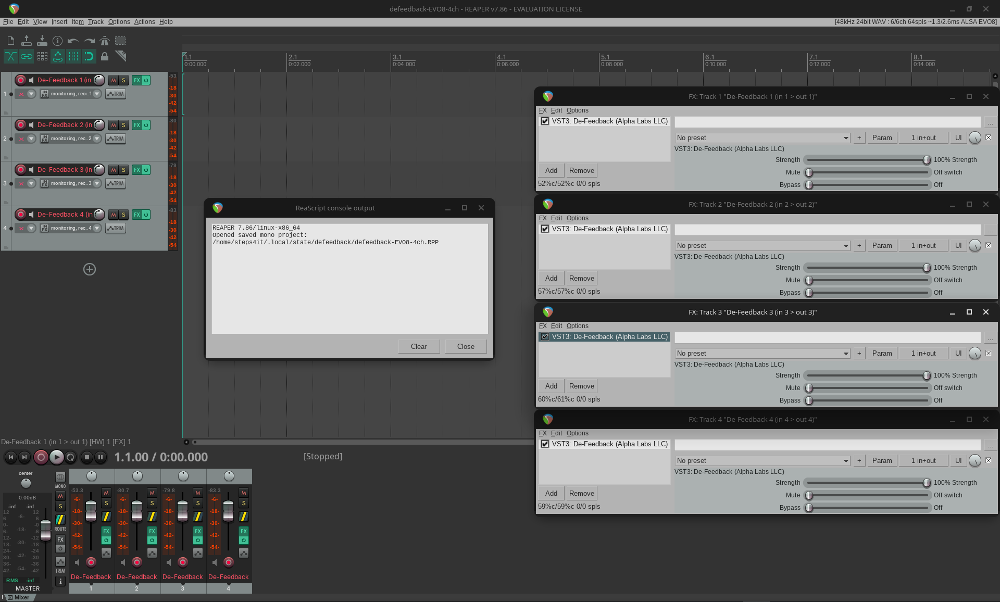
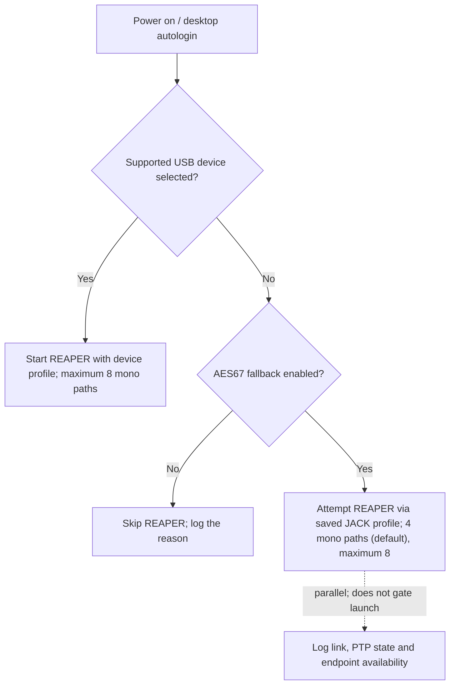
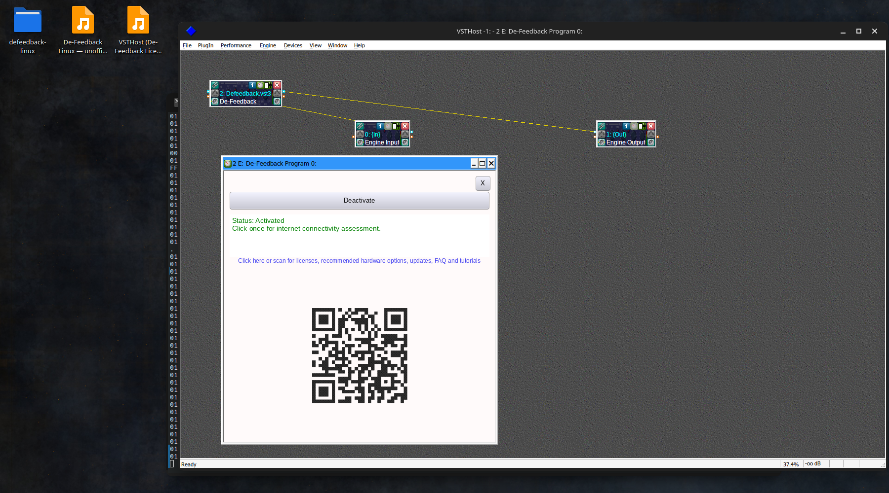

# Install De-Feedback on Ubuntu Studio

Use [the workstation command](commands.md) for daily operation and device-side Git updates. Use [the installation reference](installation.md) for the download manifest, offline preparation, and the list of changes setup makes.

Copy the entire `defeedback-linux` folder to the target computer. In the Ubuntu Studio desktop session, open a terminal in that folder and run the script as your regular user.

```bash
bash setup-defeedback.sh
```

The script uses `sudo` for Ubuntu packages and installs REAPER, yabridge, and patched Wine in your home directory. It reuses an existing patched Wine build when available. On a fresh machine it compiles the Direct2D/DirectComposition Wine fork from source, which can take a while on the target computer. The runtime lives at `~/.local/opt/defeedback-wine-dcomp/runtime`. [Wine fork and build notes](https://github.com/giang17/wine/blob/d2d1-dcomp-11.0/PATCHES.md)

Close REAPER and VSTHost before updating an existing installation. Setup updates the permanent `~/.wine-defeedback` prefix in place and reuses its installed VST3. Use the installed REAPER launcher so yabridge gets the patched Wine loader and server. REAPER gets desktop and applications-menu entries; VSTHost entries are added when its package is available. The `defeedback-linux`, `reaper`, `vsthost`, and `yabridgectl` commands are linked into `~/.local/bin`. Open a new Konsole tab, or run `export PATH="$HOME/.local/bin:$PATH"` for the current terminal. [yabridge Wine configuration](https://github.com/robbert-vdh/yabridge#configuration)

Download the Windows installer and optional VSTHost x64 archive manually from Alpha Labs. Complete the three acknowledgements on the website, then put `DefeedbackSetup.exe` in `packages/` and extract VSTHost to `packages/vsthostx64/` if you need it. [Alpha Labs download page](https://www.alphalabsaudio.com/defeedback/) On a new installation, setup opens it through Wine so each user can review and accept the Alpha Labs terms in the installer. Add your Linux packages to the same directory or supply their directory with `bash setup-defeedback.sh '/path/to/packages'`.

| Package | File name or directory |
| --- | --- |
| REAPER for Linux x86-64 | `reaper*_linux_x86_64.tar.xz` |
| yabridge for x86-64 | `yabridge-*.tar.gz` or its `.tar.gz.zip` wrapper from GitHub Actions |
| yabridgectl | `yabridgectl-*.tar.gz` or `.tar.gz.zip` from the same build if provided separately |
| VSTHost x64 with all companion files | `vsthostx64/` |
| Extracted yabridge | `yabridge/` containing `yabridgectl` and the bridge files |

For missing archives, the script downloads the REAPER version in the resource manifest and checks its published SHA-256. It fetches the current yabridge development build via the project's nightly.link page. APT may also need internet access. Use a development build of yabridge with the patched Wine runtime. [REAPER](https://www.reaper.fm/download.php?hashes=1) · [yabridge](https://github.com/robbert-vdh/yabridge#troubleshooting-common-issues)

## First audio test with Focusrite

Connect the Scarlett and turn off **Direct Monitor**. Open REAPER from the applications menu or run `defeedback-linux`. Under **Options → Preferences → Audio → Device**, select **ALSA**, choose the Scarlett for input and output, then apply these settings.

| ALSA setting | Value |
| --- | --- |
| Sample rate | 48000 Hz |
| Block size | 64 samples |
| Bit depth | 24-bit |
| Periods | 3 |
| RT priority | 50 |

The automatic launcher reapplies these ALSA settings on each launch. Check the active audio format in REAPER. For a manual buffer test, keep REAPER open while changing the setting; the next automatic launch restores 64 samples. [REAPER User Guide](https://dlx.reaper.fm/userguide/html/)

The Scarlett Solo 3rd Gen measured **8.1 ms round-trip latency with De-Feedback active**. See [the measurement setup](overview.md#measure-stability-and-latency).

If De-Feedback is not found, scan `~/.vst3` under **Plug-ins → VST**. Use the generated mono project, bypass its FX for the initial routing check, then enable De-Feedback.

See [test hardware and validation status](overview.md#validation-status) for confirmed channel counts. The common USB configuration is **48 kHz, 24-bit, 64 samples, and 3 periods**. CQ12T uses five tested paths, inputs **6–10 → outputs 1–5**; see [console routing](reaper-projects.md#cq-signal-flow-and-channel-mapping).

## Mono routing templates

The launcher uses `reaper/create-template.lua` to create a mono project for the detected USB device. For manual routing, including AES67, load the installed `~/.local/share/defeedback/reaper/create-template.lua` in REAPER's Actions window and choose a profile. See [templates and mappings](reaper-projects.md).

## Dedicated workstation startup

The goal is headless operation with audio settings selected at boot for the connected USB interface or AES67 on the second NIC. USB selection is implemented; automatic AES67 startup remains planned. A graphical Plasma session is still required. Boot without a monitor has been validated on the reference Beelink. De-Feedback activation and EVO8 appliance autostart with four mono instances have been confirmed; see [validation status](overview.md#validation-status).

Installation and boot startup are separate steps. First run `bash setup-defeedback.sh` from the Linux bundle directory. After installation, optionally enable desktop autologin and REAPER autostart:

```bash
defeedback-linux appliance setup
```

For a new workstation, `bash setup-defeedback.sh --appliance` installs De-Feedback and configures startup in one step. Normal installation and updates do not enable appliance settings. An existing installation can run `defeedback-linux appliance setup` directly. Use the account that should log in automatically, from its Ubuntu Studio Plasma desktop. Anyone with physical access can use this desktop after boot.

SDDM signs in to the current Plasma session type at boot. The systemd user service waits three seconds and calls the same hardware-aware launcher as the desktop shortcut. The launcher waits up to ten seconds for a recognized USB capture/playback device, selects its ALSA preferences, and creates or reopens its mono project. A graphical user session is still required for REAPER and the plugin; startup runs without interaction after automatic login. See [automatic USB startup](#automatic-usb-startup).

This profile turns off Plasma notification sounds, Baloo file indexing, session restore, and idle screen locking and blanking. It disables system sleep and hibernation and sets the power button to shut down. Plasma uses the performance profile on AC when the machine advertises it. The profile also stops and masks ModemManager and the installed CUPS print services and activation units.

To allow printing or mobile broadband again, unmask the units for that feature. Reboot to start any of those units that were enabled before masking.

```bash
sudo systemctl unmask cups.service cups.socket cups.path cups-browsed.service
sudo systemctl unmask ModemManager.service
```

Reboot when ready and verify that the desktop and REAPER appear. Check the REAPER service with `systemctl --user status defeedback-reaper.service` and its boot log with `journalctl --user -u defeedback-reaper.service -b`. See [service status and troubleshooting](logging.md#check-the-autostart-service) for the status commands and their meaning. Test the physical power button after saving the project.

The reference Beelink successfully started REAPER 7.86 automatically with the Audient EVO8 connected and reopened its four-mono-path project with the activated De-Feedback plugin. The screenshot shows ALSA EVO8 at 48 kHz, 24-bit, and 64 samples, with each plugin exposing one input and one output.



To stop REAPER from starting at login, run `systemctl --user disable defeedback-reaper.service`. To turn off automatic login, run `sudo kwriteconfig6 --file /etc/sddm.conf --group Autologin --key User ""`. Setup saves an existing `/etc/sddm.conf` to `/etc/sddm.conf.before-defeedback` on the first run. To restore the system sleep and power-button defaults, remove the `90-defeedback-appliance.conf` files from `/etc/systemd/sleep.conf.d/` and `/etc/systemd/logind.conf.d/`, then reboot. Adjust the corresponding desktop preferences in Plasma System Settings.

### Startup selection

USB has priority. AES67 fallback is **disabled by default**. Enable the experimental early-start test as described in [AES67 activation](aes67.md#enable-experimental-startup-fallback).



The enabled fallback attempts to launch REAPER before stream tests complete. The supervisor performs checks after spawning the process and logs transitions while REAPER runs. This makes it possible to test whether REAPER opens and whether ports/routing become usable later. It does not guarantee audio readiness or successful template creation when ports are absent; check the session and template logs.

The setting persists across boots and applies to automatic device selection only. An explicit missing USB selection or ambiguous devices do not silently select AES67. Disabling fallback affects the next launch and does not interrupt running audio.

On the reference Beelink, AES67 uses `enp2s0` and control/Internet uses `enp1s0`. PTP and the AES67 helper still need to be started separately. Automatic service startup, subscriptions/routing when streams appear, and recovery are still planned. The full live-ready startup goal requires those steps and hardware validation; the early-start mode is a test facility, not that completed implementation.

## If the Wine installer cannot extract files

Run `bash setup-defeedback.sh` from your Ubuntu Studio desktop session. Setup gives the Alpha Labs installer a writable temporary folder on the Wine C: drive and waits for you to complete the installer:

1. Click **Extract** in the Alpha Labs window.
2. Read the terms in the separate **End User License Agreement EULA** window and click **Accept** if you agree.
3. In **Browse for Folder**, select `C:\Program Files\Common Files\VST3` and click **OK**.
4. Dismiss the success message and close the installer if it is still open. Setup then registers the extracted plugin with yabridge.

Wine's terminal output is saved in `${XDG_STATE_HOME:-$HOME/.local/state}/defeedback/wine-installer.log`.

## Setup logs and diagnostics

After its initial environment checks, `setup-defeedback.sh` saves terminal output and errors to a timestamped `setup-*.log.*` under `${XDG_STATE_HOME:-$HOME/.local/state}/defeedback/logs/`. The terminal displays each installation stage and prints the log path on exit, including after an installation failure.

Run `defeedback-linux diagnose` to collect system information, USB topology, ALSA devices and stream parameters, PipeWire routing, and available USB kernel messages in `diagnostics-*` under the central log directory. The terminal shows the result of each check and the full report path. Set `NO_COLOR=1` to turn off the script's terminal colors.

For a direct SQ USB test, close REAPER and run `defeedback-linux diagnose --usb-card SQ`. Use the card ID shown in brackets in `/proc/asound/cards` for other devices. The optional tests open capture and playback separately at 48 kHz with two channels and 24-bit samples on the application side. Playback sends silence and capture is discarded. These tests verify stream access. Verify the physical signal and mixer patch separately. Review the report before sharing it, since it contains device names and system details.

If extraction under Wine fails, run the official installer on Windows, review the terms, and accept them if you agree. Copy the resulting `Defeedback.vst3` into the Linux setup's `packages/` directory. If it is a folder, copy the whole folder. Then run `bash setup-defeedback.sh --import-vst3` to import the plugin into the Wine prefix and register it with yabridge. For a custom package directory, place the VST3 there and pass that directory after `--import-vst3`.

## License management in VSTHost

To activate De-Feedback, use the complete 64-bit VSTHost folder in `packages/vsthostx64/`, including its license and Data folder. If VSTHost is not installed, add that folder to the Linux bundle and rerun `bash setup-defeedback.sh`.

1. Close REAPER and VSTHost, then run `defeedback-linux open-license-gui` from the Ubuntu Studio desktop terminal. This opens De-Feedback in VSTHost without audio, using the permanent Wine prefix shared with REAPER.
2. Click the plug-in edit dial to open the De-Feedback editor, then select **Options → License Management**.
3. Follow the regular **De-Feedback / Alpha Labs activation steps for Windows** in that window. Enter the credentials requested by Alpha Labs there and complete the activation prompts. The Linux command opens the interface; activation is handled by De-Feedback itself. See [Alpha Labs De-Feedback](https://www.alphalabsaudio.com/defeedback/) for vendor instructions and support.
4. Wait for the activation prompts to finish, close VSTHost, and start REAPER with `defeedback-linux`.

The VSTHost desktop shortcut opens the same permanent prefix. Activation succeeded on the reference Beelink, and the activated plugin subsequently loaded in REAPER with four mono EVO8 paths; see [validation status](overview.md#validation-status). REAPER requires its own separate license.



The desktop shortcuts provide two entry points: **De-Feedback Linux** starts REAPER through the hardware-aware launcher with the device's mono project, while **VSTHost (De-Feedback License)** opens De-Feedback for activation. Close VSTHost before starting REAPER.

## Automatic USB startup

The installed launcher selects the device and loads its routing template. Use `--appliance` to also enable automatic login and REAPER startup. The desktop shortcut, `defeedback-linux`, and `defeedback-reaper.service` use the same USB selection logic.

| Detected device | Default mono paths | Input → output mapping |
| --- | --- | --- |
| Focusrite Scarlett | Largest of 4, 2, or 1 that fits | Matching channel numbers |
| Audient EVO8 | Up to 4 | Matching channel numbers |
| Behringer UMC202HD (`U192k`) | 2 | 1–2 → 1–2 |
| CQ12T | 5 | 6–10 → 1–5 |
| CQ18T / CQ20B | 8 | 9–16 → 1–8 |
| SQ / QU | Up to 8 | Matching channel numbers |

Scarlett takes priority when several supported devices are connected. Other ambiguous combinations require an explicit device selection. QU and CQ18T/CQ20B profiles remain unvalidated.

The launcher configures ALSA at 48000 Hz, 24-bit, 64 samples, 3 periods, and RT priority 50. Device-specific preferences are stored in `~/.config/REAPER/reaper-defeedback-DEVICE.ini`. Existing device preferences are preserved, otherwise REAPER preferences are used as a seed. If neither exists, the launcher generates a minimal configuration.

On first launch, REAPER runs the template action without prompts and saves `~/.local/state/defeedback/defeedback-DEVICE-Nch.RPP`. Each plugin is configured and checked for one input and one output before the next instance is created. Subsequent launches reopen that saved project and check mono I/O. Move the saved project aside to regenerate it from the source. Generated tracks have active FX and monitoring, are unmuted, and have their master sends disabled. Mixer patching is configured separately by the operator.

Run `defeedback-linux --detect` to inspect the automatic device selection without starting REAPER. Use `defeedback-linux --device cq`, an exact ID such as `defeedback-linux --device hw:CQ12T`, or `defeedback-linux --channels 2` to override selection or channel count. `DEFEEDBACK_DEVICE` and `DEFEEDBACK_CHANNELS` provide the same overrides for desktop and service environments. Explicit REAPER arguments are forwarded after device configuration. `defeedback-linux --raw` bypasses automatic selection and uses saved REAPER preferences.

`defeedback-linux --device aes67` explicitly uses the [managed JACK profile](aes67.md#enable-experimental-startup-fallback), even with USB connected or automatic fallback disabled. It defaults to four mono paths and starts without readiness gating; `defeedback-linux check avantis --launch` checks endpoint presence first.

Launcher events, REAPER output, and process status are saved as bounded session logs under `~/.local/state/defeedback/logs/`. Template/version/mono-validation messages use rotating `template-DEVICE-Nch.log` files there. Use `defeedback-linux logs --list` to find current and older logs. XDG configuration and state directory overrides are honored. See [logging](logging.md).

With no matching USB device, the default `--missing-audio skip` logs the reason and exits successfully without starting REAPER. Use `--missing-audio error` or `DEFEEDBACK_MISSING_AUDIO=error` for an error exit instead. `--detect` reports missing devices as errors. Ambiguous devices and invalid routing remain errors. `--raw` bypasses automatic USB checks.

AES67 is started manually after network and PTP checks; see [AES67 setup](aes67.md). Automatic AES67 startup is not configured.


## Update the workstation

Use `defeedback-linux update` to fetch and apply project code on the device, or `defeedback-linux update --reaper` to also update REAPER. See [Git update behavior](commands.md#git-updates-on-the-device). The commands below apply a bundle you have already updated manually.

Close REAPER, then run `bash update-defeedback.sh` from the updated bundle on the Linux computer. The default selects the current stable release from the official REAPER download page, verifies its published SHA-256, and updates REAPER plus the hardware-aware launcher, template action, and supplied template resources. The updater targets REAPER 7.x and requires at least 7.43 for automatic mono bus requests. Check license coverage before selecting a different major version. See the [REAPER changelog](https://www.reaper.fm/download-old.php?ver=7x).

Use `bash update-defeedback.sh --check` to inspect the selected release, `--pinned` to install the manifest version, or `--integration-only` to update just the launcher and templates. For an offline REAPER update, pass `--archive /path/to/reaperVERSION_linux_x86_64.tar.xz --sha256 PUBLISHED_SHA256`; the checksum may be omitted only when the archive filename matches the manifest entry. Selecting `--pinned` or a local archive installs that selected version, which can also be used for a deliberate downgrade.

Updates use the same locks as setup and the REAPER launcher and require REAPER to be closed. Before replacing files, the updater copies the REAPER resource directory, generated projects, and existing integration files into a timestamped directory under `${XDG_STATE_HOME:-$HOME/.local/state}/defeedback/`, with an `update.log`. The previous runtime remains beside the installed runtime as `~/.local/opt/REAPER.before-update-TIMESTAMP-ID`. An installation failure restores the runtime and any integration files already changed. The existing desktop shortcut continues to call the same launcher path. Plugin, Wine, and yabridge version changes remain separate maintenance operations.

## Remove optional applications

Preview optional desktop and creative application removal:

```bash
defeedback-linux trim --check
defeedback-linux trim --apply
```

Add `--autoremove` to both commands to include unused automatic dependencies. The script saves the resolved plan under `~/.local/state/defeedback/logs/` and stops if protected desktop, audio, AES67, or system runtime packages would be removed. Review the plan before applying it. Personal documents are retained; Snap removal normally retains a recovery snapshot.
